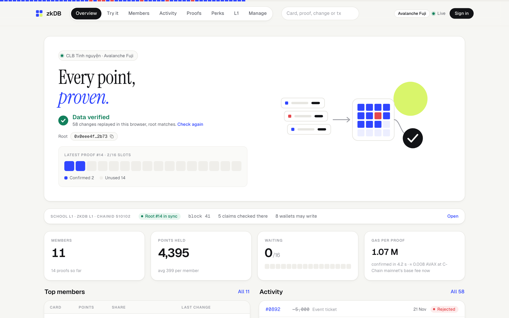
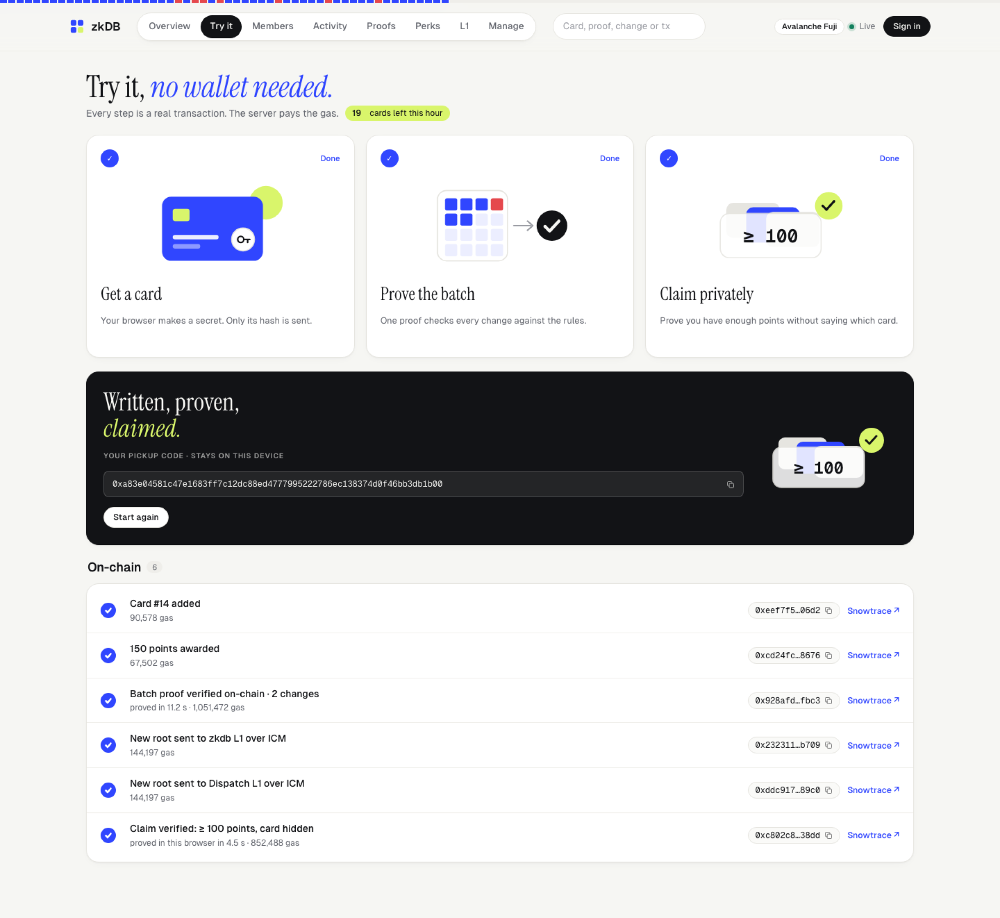
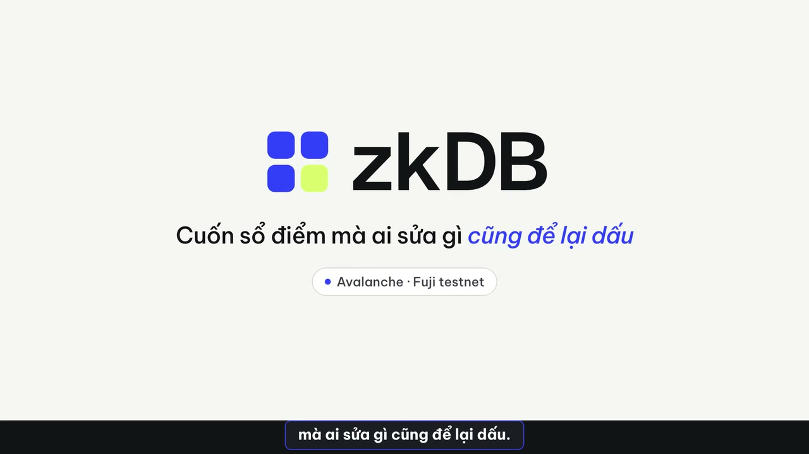
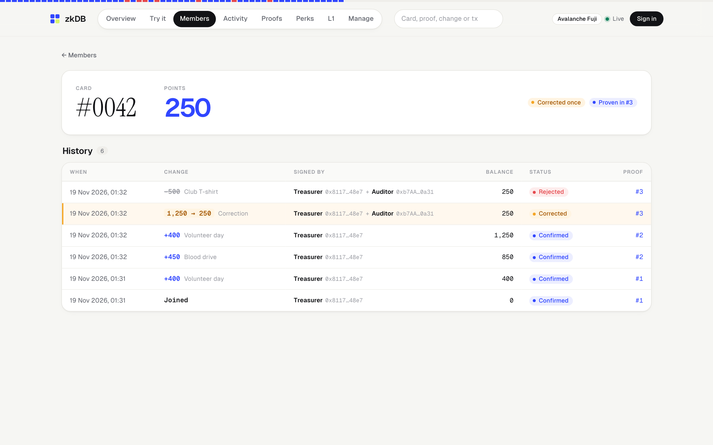
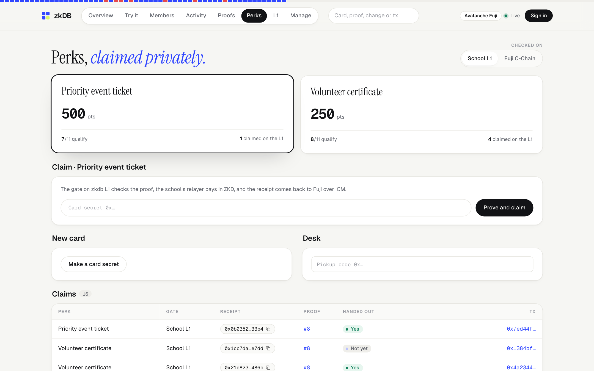
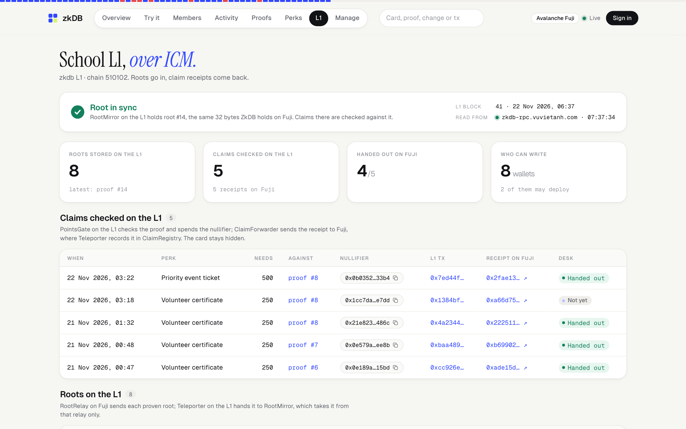
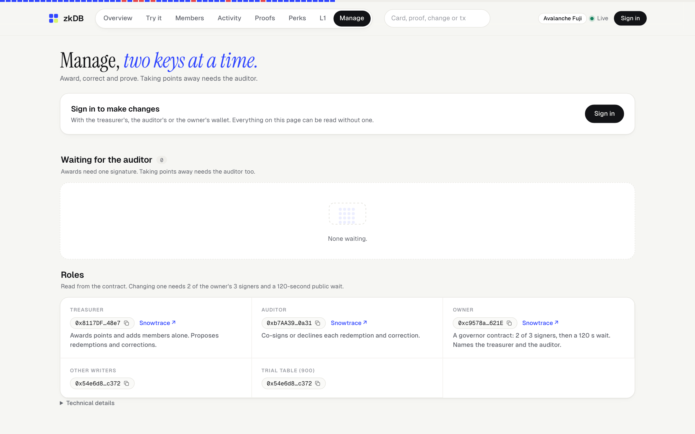
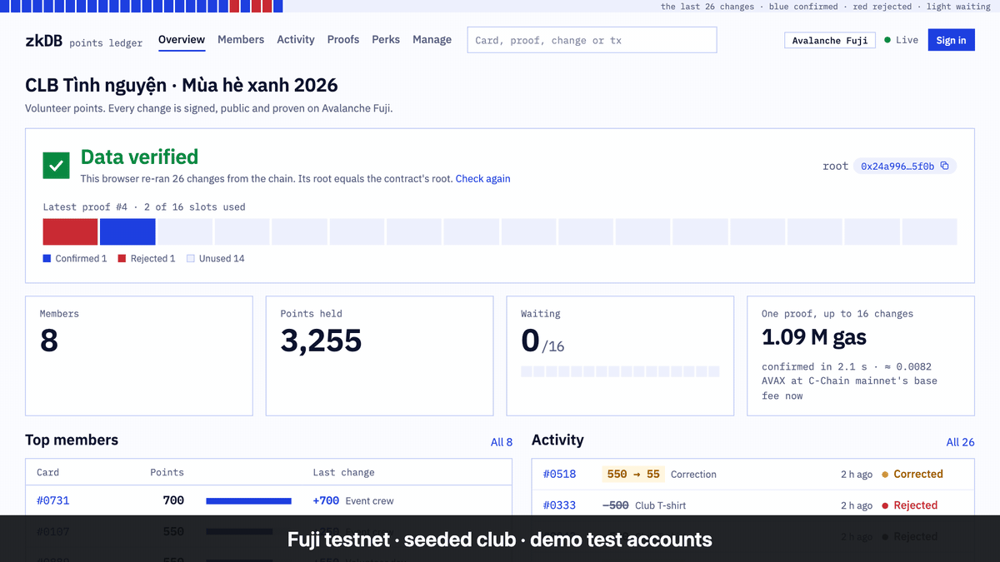

# zkDB

**A points ledger nobody can quietly edit.** Every change to a balance is public and names its signer, taking points away needs two signers, each batch of changes is checked by a validity proof on Avalanche, and a member can prove "I have at least N points" without showing which card is theirs.

[**Live app**](https://zkdb.vuvietanh.com) · [**Try it without a wallet**](https://zkdb.vuvietanh.com/#try) · [**Demo video (2 min)**](docs/media/zkdb-demo.mp4) · [**Slides**](docs/zkdb-pitch.pdf) · [Architecture](docs/ARCHITECTURE.md)



| | |
|---|---|
| Networks | Avalanche Fuji C-Chain and the school's own Avalanche L1 `zkdb` (chainId 510102), linked both ways over ICM |
| Proofs | Noir circuits, UltraHonk verifier on-chain; up to 16 changes per batch, about 1.05M gas, proved in 1 to 2 s |
| Contracts | 8 source-verified on Fuji, 4 on the L1 ([addresses](#live-on-avalanche-fuji)) |
| Admin | A 2-of-3 governor with a 120 s timelock owns the ledger; no single key can change its rules |
| Tests | 87 contract · 30 core · 123 dashboard · 3 SDK · 29 circuit ([commands](#tests)) |
| Public L1 RPC | `https://zkdb-rpc.vuvietanh.com` (read-only) |

## Contents

- [Try it in two minutes](#try-it-in-two-minutes)
- [The problem](#the-problem) · [What zkDB does about it](#what-zkdb-does-about-it) · [How it works](#how-it-works)
- [Screens](#screens)
- [Own L1 and ICM](#own-l1-and-icm)
- [What runs where](#what-runs-where)
- [Live on Avalanche Fuji](#live-on-avalanche-fuji)
- [What it is as a database](#what-it-is-as-a-database) · [Why a proof and not a plain contract](#why-a-proof-and-not-a-plain-contract)
- [Why on-chain, why Avalanche, where the money comes from](#why-on-chain-why-avalanche-where-the-money-comes-from)
- [Run it](#run-it) · [Tests](#tests) · [Limits](#limits) · [Built when](#built-when) · [Repository](#repository)

## Try it in two minutes

Open [zkdb.vuvietanh.com/#try](https://zkdb.vuvietanh.com/#try). No wallet, no AVAX, three buttons:

1. **Get a trial card.** Your browser makes a card secret and sends only its hash. The card is added to the ledger and awarded 150 points.
2. **Prove and submit.** One proof covers the batch of changes; the contract on Fuji verifies it before it accepts the new root, and the root is sent on to the `zkdb` L1.
3. **Prove and claim.** Your browser proves "this card has at least 100 points". The contract accepts the claim without learning which card it was.

Every step lists its transaction with an explorer link. A run on the public site on 22 Nov 2026: batch proof [0x928afdae…](https://testnet.snowtrace.io/tx/0x928afdaeebe287ead7b9f5b0d099e631537423100418962dbea15ed6944dfbc3), root to the L1 [0x23231132…](https://testnet.snowtrace.io/tx/0x232311324f9404fbac6cd9862fb1c15845ad19b5977d6661166124d91a3bb709), claim [0xc802c80a…](https://testnet.snowtrace.io/tx/0xc802c80a0faa9045dbab8fc39aab6420b92f7f9cb77eecffc1607c17141b38dd).



## The problem

Vietnamese students collect points for volunteering: *Mùa hè xanh* days, blood drives, community-service days. The points feed the official *điểm rèn luyện*, which goes on the transcript and decides scholarships ([Thông tư 40/2026/TT-BGDĐT](https://datafiles.chinhphu.vn/cpp/files/vbpq/2026/5/40-bgddt.pdf), Điều 17 and 18.6). About 2.6 million undergraduates at 226 institutions are scored this way ([Tuổi Trẻ, 9 Oct 2026](https://tuoitre.vn/hon-27-trieu-nguoi-dang-hoc-tu-dai-hoc-den-tien-si-o-viet-nam-100261009084431012.htm); [Tiền Phong, 4 Oct 2026](https://tienphong.vn/226-co-so-giao-duc-dai-hoc-va-bai-toan-sap-xep-tranh-trung-lap-post1882018.tpo)).

The record is kept by whoever runs the activity, in a spreadsheet or a school portal, and that same party is the only one who can check it. Two things that went wrong:

- In 2026 three defendants were sentenced for making or selling fake community-service certificates to students of Saigon Technology University (STU). One made 373 certificates for 63 students (13 years 6 months, not appealed). One bought certificates from him and sold 204 to 32 students (10 years on appeal). One made 53 and sold 23 of them to 4 students at 400,000 VND per set of 15 days (9 years on appeal) ([Tiền Phong, 24 Jun 2026](https://tienphong.vn/giam-an-cho-2-bi-cao-ban-giay-xac-nhan-rom-cho-sinh-vien-truong-dai-hoc-cong-nghe-sai-gon-post1854004.tpo)). zkDB would not have stopped an insider who signs a false award. It would have put every award on a public record under the signer's address, where a school can see who issued it and when.
- One university's scoring software gave many students an average mark by mistake ([VietNamNet, 25 Sep 2014](https://vietnamnet.vn/sinh-vien-phai-lam-lao-cong-doi-diem-ren-luyen-198908.html)).

The new regulation asks for results that are "khách quan, công bằng, công khai, minh bạch", gives students at least five days to object before a result is final (Điều 18.4), and scores schools on digital transformation of student affairs (Điều 27.6a). A member whose 1,250 points became 250 still has no way to see who changed it.

## What zkDB does about it

| | |
|---|---|
| Every change is public and names its signer | The op and the account that asked for it are in an event; the member page shows "Signed by" on every row |
| A treasurer cannot take points away alone | On a table with an auditor, a redemption or a correction is only a proposal until the auditor co-signs it on-chain. A correction then reads *Corrected*, with both addresses, for good. One signer can still award points and add a member |
| Spending more than the balance does nothing | The proof marks the redemption *Rejected* and the balance stays |
| A member can prove eligibility without showing the card | "A card in this ledger has at least N points and I hold its secret", proven in the member's browser, checked by a contract. This part is zero-knowledge |
| Anyone can re-check everything | The browser re-runs every change from chain data and compares its root with the contract's |

## How it works

1. Queue. The treasurer awards points or adds a member. Each action is one transaction that appends an op to the contract's queue. Nothing changes yet; it shows as *Waiting*.
2. Take away, with two signatures. To redeem points or overwrite a balance the treasurer calls `proposeChange`. The op enters the queue only when the table's auditor calls `approveChange` with the same op (or `declineChange`).
3. Prove. A prover takes up to 16 waiting ops from the chain, applies them to a Poseidon2 Merkle tree and makes an UltraHonk proof (Noir circuit, bb.js) that `oldRoot → newRoot` followed the rules. An op that breaks a rule gets `ok = false`, and the proof covers that too.
4. Verify. `submitBatch` checks the ops against the queue, calls the on-chain verifier and only then stores the new root. Anyone can call it.
5. Relay. `RootRelay` sends the new root to another Avalanche L1 through Teleporter (ICM). On the zkdb L1, `RootMirror` stores it, a `PointsGate` there checks claims against it, and `ClaimForwarder` sends each accepted claim's receipt back to `ClaimRegistry` on the C-Chain.
6. Check. Any browser rebuilds the database from the public op log and compares roots: *Data verified* or *Data does not match*.
7. Claim. On the Perks page the member's browser, which holds the card's secret, proves "a card in the current root has at least N points" and makes the claim out to the hash of a one-time pickup code. A relayer sends the proof to `PointsGate`, which checks it against `ZkDB.root()`. A copied proof cannot be redirected: the pickup hash is a public input of the proof, and only the holder of the code can collect the perk at the desk (`collect`).

Diagrams, the opcode table and the threat model: [docs/ARCHITECTURE.md](docs/ARCHITECTURE.md). Circuits and toolchain: [docs/design.md](docs/design.md).

## Screens

[](docs/media/zkdb-demo.mp4)

The video (2:08, Vietnamese narration and subtitles) walks through the live site: a corrected balance and its two signers, the no-wallet trial, re-checking the ledger in the browser, a rejected overspend, the school's L1 and the governor that owns the ledger.

| | |
|---|---|
|  |  |
|  |  |
|  |  |

An earlier recording of the two-signer flow (19 Nov 2026, previous interface):



The GIF was recorded against the Fuji deployment below on 19 Nov 2026 (1280 × 720 viewport, demo test accounts, seeded club). The treasurer proposes cutting card #0889 from 550 to 55 and a redemption of 500 points from a card that has 150; the auditor co-signs both; one proof applies the correction and rejects the overspend; a member proves "at least 500 points" without naming the card; a card with too few points gets "No proof exists"; the proof page shows the root was received on Dispatch and not executed.

## Own L1 and ICM

Perk claims run on the school's own Avalanche L1 `zkdb`, where only wallets the school enabled can send transactions or deploy contracts (TxAllowList and ContractDeployerAllowList, [l1/](l1/README.md)); proven roots go to it and claim receipts come back to the Fuji C-Chain over ICM, and the dashboard's School L1 page lists both and reads the L1 itself through its public RPC: the root it holds, each L1 transaction, who is on the allow-lists ([screenshot](docs/media/school-l1.png)).

| Proof (21 Nov 2026, after the allow-list upgrade) | Sent | Received and executed |
|---|---|---|
| Fuji → L1: proven root #8 to RootMirror | [0x81d13b6c…](https://testnet.snowtrace.io/tx/0x81d13b6c4dc9f0b717279bf141fd6330723c9621be460381d6a1409a487d44fc) (Fuji) | `0xfd7e0c12…` on the L1, `MessageExecuted` |
| L1 → Fuji: ZK claim checked on the L1, sent by a claim relayer the school enabled that night | `0x4a2344dc…` on the L1 | [0x222511e3…](https://testnet.snowtrace.io/tx/0x222511e3ad45f3ff720af25122e8c94697e1bf843d94ba16b95bec275623485d) (Fuji), `MessageExecuted` in ClaimRegistry |
| Permissions: an outsider holding ZKD is refused; the admin enables a new deployer and claim relayer, who then deploy and send; the deployer is offboarded and refused again | [docs/l1-permissions.md](docs/l1-permissions.md) (`npm run perms:l1`) | node errors and L1 hashes |
| The L1 exists, is converted, has its validator; its genesis is [l1/genesis.json](l1/genesis.json) | P-Chain `getSubnet`, `getCurrentValidators`, `getTx` ([commands](l1/README.md#check-it)) | |

Earlier runs (roots #6 and #7 and their receipts, before the upgrade): [docs/l1-run.md](docs/l1-run.md). Limits: one validator on a server the project runs, no block explorer for the L1 (its RPC is public and read-only), the PoA owner is a project key, validator balance topped up daily.

## What runs where

What was added on 22 Nov 2026, and where each piece runs today. "anvil" means a local chain started by the test or script with the real contracts and the real provers; nothing in those runs is mocked except the chain.

| Change | Code and tests | On Fuji |
|---|---|---|
| **No single admin key.** [`AdminGovernor`](contracts/src/AdminGovernor.sol): every ZkDB admin call (turn the auditor rule off or on, change writers, assign tables, hand ownership on) needs 2 of N signers, then waits a public delay; any one signer can cancel. Changing signers, threshold or delay goes through the same path and voids pending actions. Threshold below 2 is refused | 24 Foundry tests, refusals included ([`AdminGovernor.t.sol`](contracts/test/AdminGovernor.t.sol)) | **Yes, 22 Nov.** The live ZkDB is owned by AdminGovernor [`0xc9578a6941a88c2b0cf00f48f2995f37e107621e`](https://testnet.snowtrace.io/address/0xc9578a6941a88c2b0cf00f48f2995f37e107621e) (source-verified; 2 of 3, 120 s delay): transfer started by the old key [0x68fc7008…](https://testnet.snowtrace.io/tx/0x68fc70084e8cc959356590f72b8bad2a3c91961d4253a0f0227e586a09dcb021), proposed [0x799aa34e…](https://testnet.snowtrace.io/tx/0x799aa34e463a658185fb0958be1f4c907fb624b2ddeecfb0da8a6a32de4b1500), approved [0x9a8765e0…](https://testnet.snowtrace.io/tx/0x9a8765e0e14b0be41bf4317cb247a46393912291bc36786c04fca938739f9cbf), executed after the delay [0x1f2901b8…](https://testnet.snowtrace.io/tx/0x1f2901b8348453c92eb93bb6271510118bdeb66180428fed646a3222adcbb4c2). Execution with one signature and before the delay was refused, and the old owner key is now refused (`NotOwner`): [docs/fuji-governance-run.md](docs/fuji-governance-run.md). Limit: the three signer keys were made on one machine |
| **One signer can only add a little.** `ZkDB.setSoloLimit(table, field, maxPerOp, maxPerDay)`: an ADD, or an INSERT's starting value, above the limit needs the auditor (proposeChange / approveChange). Off by default, so existing behaviour is unchanged | 9 Foundry tests ([`SoloLimit.t.sol`](contracts/test/SoloLimit.t.sol)) and 1 governor test; the 54 earlier tests pass unchanged | **No.** Needs a new ZkDB deployment; the live ZkDB is the 19 Nov bytecode without it |
| **Try it with no wallet and no AVAX.** Page *Try it*: the visitor's browser makes a card secret and sends only its hash; the server's trial key adds the card to a separate table (900) and awards points, proves the batch, submits it and sends the new root on to the zkdb L1; the browser proves the "at least 100" claim and the claim relayer sends it. Every step shows its explorer link. Capped per hour and per visitor | [`trial.test.ts`](packages/dashboard/test/trial.test.ts): the whole flow on anvil with the real batch and claim provers, the root relay included; the API through the dev UI proxy on `npm run demo` | **Yes, 22 Nov, on the live contracts** (no redeploy): setup in [docs/fuji-trial-setup.md](docs/fuji-trial-setup.md). Two full runs through the page that day: card [0x80dc5d6b…](https://testnet.snowtrace.io/tx/0x80dc5d6b29f653fdc71ba9843ac6e94b68513ebbda90ed3a58977d7b56756049), award [0x7341af38…](https://testnet.snowtrace.io/tx/0x7341af3826491383fc4a99ba18d1e16a2e913e6ccad9216bf3fb20c5fd37f3af), batch proof #10 [0x3dde6788…](https://testnet.snowtrace.io/tx/0x3dde6788e70eea5eb1b313afe3f3778d0063196ee52444f1a01a268c8f7f3c95), root sent to the zkdb L1 [0xe5398964…](https://testnet.snowtrace.io/tx/0xe539896491ab9bbbae8e015e96f6766424b8b296e7282fe690955d0e54f955d0) (RootMirror there holds #10), claim [0x7a470c12…](https://testnet.snowtrace.io/tx/0x7a470c126b9c9cc364e0737e0f6a7350c10ae03ad5d4d6b66458caef2eac5d7b); the first run made proof #9 [0x4cfb8868…](https://testnet.snowtrace.io/tx/0x4cfb8868ccbef8d831194e33461175a4f2e592910a62d26e51baf88c0e822d4b). On the public site since 22 Nov: https://zkdb.vuvietanh.com/#try. A run through it that morning: batch proof [0x928afdae…](https://testnet.snowtrace.io/tx/0x928afdaeebe287ead7b9f5b0d099e631537423100418962dbea15ed6944dfbc3), root to the zkdb L1 [0x23231132…](https://testnet.snowtrace.io/tx/0x232311324f9404fbac6cd9862fb1c15845ad19b5977d6661166124d91a3bb709), claim [0xc802c80a…](https://testnet.snowtrace.io/tx/0xc802c80a0faa9045dbab8fc39aab6420b92f7f9cb77eecffc1607c17141b38dd). The batch proof is made on the project's server (about 11 s there) |
| **SDK.** [`@zkdb/sdk`](packages/sdk/README.md): create a ledger, write a proven batch, prove / check / record an "at least N" claim | 3 tests on anvil with the real provers; `npm run quickstart -w @zkdb/sdk` | **Yes, through the café app below**, which calls nothing else: `createLedger`, `queue`, `writeBatch`, `addThreshold`, `proveThreshold`, `checkThreshold`, `submitThreshold`. The quickstart itself has not been run on Fuji |
| **A second app on the SDK.** [Café stamp card](packages/example-cafe/cafe.ts): 10 stamps earn a coffee, the customer proves it without saying which card | Runs on anvil: 2 cards, one proven batch, a reward claimed once, a second claim refused, a 4-stamp card cannot prove | **Yes, 22 Nov**, on its own contracts: ZkDB [`0xe0cd8ecef235219cae14ced3fea30293932b41d2`](https://testnet.snowtrace.io/address/0xe0cd8ecef235219cae14ced3fea30293932b41d2), reward gate [`0x41a0b367d1897478aae5be116a23b26b77e74eb5`](https://testnet.snowtrace.io/address/0x41a0b367d1897478aae5be116a23b26b77e74eb5) (not source-verified). Batch proof of 5 changes [0x16eefbd4…](https://testnet.snowtrace.io/tx/0x16eefbd4355ba27a3dc2a1c22086a60bcf4b878be94a2bca8b7cebebcdedc292), free coffee recorded with the card hidden [0x83cd5576…](https://testnet.snowtrace.io/tx/0x83cd5576a66f42a468c189f78d699c8017cb077d6a9897fb740e8c3dfd73e78f); all 7 transactions in [docs/cafe-fuji-run.md](docs/cafe-fuji-run.md). It is a script, not a web app |
| **Own L1 off the laptop** | — | **Yes, since the evening of 21 Nov.** The validator runs on a separate always-on server, with a public read-only RPC: `https://zkdb-rpc.vuvietanh.com`, chainId 510102 ([l1/README.md](l1/README.md#check-it)). Still one validator, run by the project; no block explorer, so the dashboard's School L1 page opens L1 transactions itself |

Not changed, and not claimed: the batch verifier cannot be swapped by anyone (it is `immutable` in ZkDB; a new verifier means a new ZkDB), and PointsGate's admin is an immutable single key that can only add perks.

## Live on Avalanche Fuji

| Contract | Address | Verified |
|---|---|---|
| ZkDB (queue, roles, co-signed changes, root) | [`0x1dd3f88db29ee55e66b8db243c99c5b7fc0ea91c`](https://testnet.snowtrace.io/address/0x1dd3f88db29ee55e66b8db243c99c5b7fc0ea91c) | yes |
| BatchVerifier (UltraHonk, batch circuit) | [`0xf5100724394b96775a74950452e6565f78c7ec5d`](https://testnet.snowtrace.io/address/0xf5100724394b96775a74950452e6565f78c7ec5d) | yes |
| PointsGate (perks by zero-knowledge claim) | [`0xe68736b7dc375a90635dec5b07e09838f4fc4c33`](https://testnet.snowtrace.io/address/0xe68736b7dc375a90635dec5b07e09838f4fc4c33) | yes |
| ClaimVerifier (UltraHonk, claim circuit) | [`0xa6728051568ccf503e57ee5ba579a7ae8a4ab4a5`](https://testnet.snowtrace.io/address/0xa6728051568ccf503e57ee5ba579a7ae8a4ab4a5) | yes |
| RootRelay (sends each root over ICM to Dispatch) | [`0x497e8189dc2d2cc07712f448f51fbe708e2e306f`](https://testnet.snowtrace.io/address/0x497e8189dc2d2cc07712f448f51fbe708e2e306f) | yes |
| RootRelay (sends each root over ICM to the zkdb L1) | [`0x1335af7535aee69c7253f22dea3b6b214891f6e5`](https://testnet.snowtrace.io/address/0x1335af7535aee69c7253f22dea3b6b214891f6e5) | yes |
| ClaimRegistry (claim receipts from the zkdb L1) | [`0xfab45908d9309ee508fa4e9a79437f47e1396d38`](https://testnet.snowtrace.io/address/0xfab45908d9309ee508fa4e9a79437f47e1396d38) | yes |

Added on 22 Nov (see [What runs where](#what-runs-where)): AdminGovernor [`0xc9578a6941a88c2b0cf00f48f2995f37e107621e`](https://testnet.snowtrace.io/address/0xc9578a6941a88c2b0cf00f48f2995f37e107621e), source-verified, which now owns the ZkDB above; the trial table (900) and perk #2 on the same ZkDB and PointsGate; the café's own ZkDB and gate. Not on Fuji: the ZkDB with `setSoloLimit` (it needs a new deployment).

Sample transactions per flow (all on the ZkDB above): a batch proof of 16 changes, [0xf54ab96c…](https://testnet.snowtrace.io/tx/0xf54ab96ce9fc38d5f4c3291a3dbd2d49749b676821d6548c8ce5972b14b54c98); a correction proposed, [0x550a7469…](https://testnet.snowtrace.io/tx/0x550a7469a9c2af5454b0d71027235af97eafcff77d338d31e8fb0a90e4d462f2), and co-signed, [0xa0547c84…](https://testnet.snowtrace.io/tx/0xa0547c84b5a1e03772022aa2db7e72a88e5483d07fd9cc1a51410a276a1ae2d2); a zero-knowledge claim, [0xbf92b577…](https://testnet.snowtrace.io/tx/0xbf92b5772f620a4c2a28a1d088965c456976a69784170e4f21617fbe504bb5be); a root sent over ICM, [0xfb2051b1…](https://testnet.snowtrace.io/tx/0xfb2051b1c2b29a87cff8f313e7dd1a6f2f5cdddba3e6266578d86837d6224832). More in the list below and in [docs/fuji-flow-run.md](docs/fuji-flow-run.md).

On the zkdb L1 (public read-only RPC `https://zkdb-rpc.vuvietanh.com`; it has no block explorer, so the dashboard's School L1 page opens L1 transactions itself): RootMirror `0x744e2be19b816f280e35ae441e6ba51f7b5d4c78`, ClaimVerifier `0xa469888cdfa2ffad68a9babbd92d29d95c577c36` (the same UltraHonk verifier, 3.45M gas to deploy, under the 30M block limit), PointsGate `0xcc825630337f42d757537e19250e7051cf6a0a67` (reads RootMirror), ClaimForwarder `0xc1e48ee74410eab7508da2e1227d26afb8721686`. Deploy transactions: [docs/l1-run.md](docs/l1-run.md).

"Verified" means source-verified on Routescan, the explorer behind testnet.snowtrace.io. This is the third deployment; the two earlier ones are superseded and the dashboard no longer reads them.

State on 21 Nov 2026: 11 members, 46 changes, 8 proofs, 17 co-signed changes (6 corrections, 11 redemptions), 5 perk claims on the Fuji gate. 8 roots sent to Dispatch: each was received by Teleporter there and not executed, because the receiving contract is not deployed on Dispatch. 3 roots sent to the zkdb L1 and 3 claim receipts sent back: all executed (see Why Avalanche: ICM). On 22 Nov the trial page added its first cards on table 900 and proofs #9 to #12, each followed by a trial claim on the Fuji gate and a root on the zkdb L1; the numbers grow with every visitor who tries it. Check it yourself:

```bash
RPC=https://avalanche-fuji-c-chain-rpc.publicnode.com
cast call 0x1dd3f88db29ee55e66b8db243c99c5b7fc0ea91c "batchCount()(uint64)" --rpc-url $RPC   # 10 or more
cast call 0x1dd3f88db29ee55e66b8db243c99c5b7fc0ea91c "head()(uint64)" --rpc-url $RPC         # 50 or more
cast call 0x1dd3f88db29ee55e66b8db243c99c5b7fc0ea91c "owner()(address)" --rpc-url $RPC       # 0xc9578a69…621E, the AdminGovernor contract
cast call 0xfab45908d9309ee508fa4e9a79437f47e1396d38 "count()(uint256)" --rpc-url $RPC       # claim receipts from the L1: 3 or more
cast call 0xe68736b7dc375a90635dec5b07e09838f4fc4c33 "perk(uint256)((uint256,uint64,uint64,string))" 0 --rpc-url $RPC
L1=https://zkdb-rpc.vuvietanh.com
cast call 0x744e2be19b816f280e35ae441e6ba51f7b5d4c78 "batchNo()(uint64)" --rpc-url $L1          # the root the L1 holds: 10 or more
cast call 0x0200000000000000000000000000000000000002 "readAllowList(address)(uint256)" 0x2cC649f2d93bF4b7d8Fb031D00B155171e99a77E --rpc-url $L1   # 0: an outsider may not send
```

Transactions worth opening:

| What | Transaction |
|---|---|
| Proof #1, 16 changes, 1,176,630 gas | [0xf54ab96c…](https://testnet.snowtrace.io/tx/0xf54ab96ce9fc38d5f4c3291a3dbd2d49749b676821d6548c8ce5972b14b54c98) |
| Treasurer proposes #0042 1,250 → 250 | [0x550a7469…](https://testnet.snowtrace.io/tx/0x550a7469a9c2af5454b0d71027235af97eafcff77d338d31e8fb0a90e4d462f2) |
| Auditor co-signs it | [0xa0547c84…](https://testnet.snowtrace.io/tx/0xa0547c84b5a1e03772022aa2db7e72a88e5483d07fd9cc1a51410a276a1ae2d2) |
| Zero-knowledge perk claim, made out to a pickup code, 852,392 gas | [0xbf92b577…](https://testnet.snowtrace.io/tx/0xbf92b5772f620a4c2a28a1d088965c456976a69784170e4f21617fbe504bb5be) |
| The perk handed out at the desk against that pickup code | [0x52d9bfec…](https://testnet.snowtrace.io/tx/0x52d9bfec14f46e9c5cd1875accd07166a120ab0a2288c061dac90adcf2c7ef99) |
| A claim proved in a browser while recording the GIF, sent by the relayer | [0x69f6e573…](https://testnet.snowtrace.io/tx/0x69f6e57345f34132bd8aab86988e5b0a44b8908a227bdb8636ccfd4a57ec3c6e) |
| Root #3 sent over ICM from the C-Chain | [0xfb2051b1…](https://testnet.snowtrace.io/tx/0xfb2051b1c2b29a87cff8f313e7dd1a6f2f5cdddba3e6266578d86837d6224832) |
| Teleporter on Dispatch receives it and cannot execute it (`MessageExecutionFailed`: no contract at the destination) | [0x6488cdb7…](https://subnets-test.avax.network/dispatch/tx/0x6488cdb7f318c9177d0efdba0c1e1fcb2643558b92a43f57e694052436fc9f26) |

All 41 seeding transactions with gas, fee and confirmation time: [docs/fuji-measurements.md](docs/fuji-measurements.md). The 13 transactions of the 20 Nov run of the main flow: [docs/fuji-flow-run.md](docs/fuji-flow-run.md).

On 21 Nov 2026 `npm run flow:fuji` ran the whole main flow again in [13 transactions](docs/fuji-flow-run.md), among them a [batch proof](https://testnet.snowtrace.io/tx/0xcebc3545b2f47098ed497398b220421921279a79791491ac56de382de54aa7af) that applied a co-signed correction and rejected an overspend and a [zero-knowledge perk claim](https://testnet.snowtrace.io/tx/0x8231674ec8e657f119ec98d2f6a88097a7643395f6defa622204c8df8e04c814); `npm run flow:l1` then sent that root to the L1 and a claim receipt back (table above).

## What it is as a database

zkDB is a ledger of numbers with proven writes, not a full database.

- Writes: five ops only (insert, set, add, subtract, delete). On a table with an auditor, subtract, set and delete need a second signer. Up to 16 changes are proven per batch; a change that breaks the rules (for example spending more than the balance) is marked failed in the proof and the balance stays.
- Reading everything: every change is an on-chain event, so anyone can rebuild the whole table and compare its Merkle root with the contract's (the dashboard shows "Data verified"). No proof is needed for that.
- Reading one row with a proof: a Merkle path from the row to the root. The circuits use it; there is no user-facing query for it.
- Private query: one kind. "A row in this table, whose secret I hold, has at least N", proven in zero knowledge, without saying which row.
- Not there: proven filters, sorting, counts, sums, joins, ranges or top-N; rows are 6 numbers; written data is public.

## Why a proof and not a plain contract

A fair question, because the ops are public and a mapping with `require(balance >= amount)` enforces the same spending rule. We measured it: the same 16 changes on an ordinary-storage ledger and on zkDB, real receipts, real proof.

| 16 changes | Plain contract | zkDB |
|---|---:|---:|
| Total gas | 750,342 | 2,443,709 |
| Per change | 46,896 | 152,731 |

`npm run gas:compare -w @zkdb/dashboard` reproduces this; details in [docs/gas-comparison.md](docs/gas-comparison.md). zkDB costs 3.3 times as much, and a bigger batch does not fix that while each change is queued in its own transaction. A design that posts changes only inside the batch would break even at about 28 changes per proof; we calculated that and did not build it.

So gas is not the reason. The proof is there for what a plain contract cannot do:

1. Private claims. `PointsGate` accepts "some card in this ledger has at least N points" without learning which card. A plain contract can check a balance only if it is told whose. The claim needs the whole ledger as one Merkle root that a circuit can open cheaply, which means a Poseidon2 tree.
2. That root is too expensive to keep by hand. Updating a depth-20 Poseidon2 tree inside the EVM takes 40 hashes per change, about 812,000 gas with the cheapest public implementation ([zemse/poseidon2-evm](https://github.com/zemse/poseidon2-evm), 20,304 gas per hash by its own report; calculated, we did not run it). The batch proof keeps the same root correct for 152,731 gas per change.
3. One root travels. 32 bytes stand for every balance. `RootRelay` sends them towards another L1 over ICM for 144,197 gas, and a gate there checks the same claims with no copy of the ledger and no trust in the club's server. This runs on our own L1 (see below).

If a club needs none of the three, a plain contract is the better choice. On the words: the batch proof is a validity proof and hides nothing. Only the claim is zero-knowledge.

## Why on-chain, why Avalanche, where the money comes from

| Question | Answer |
|---|---|
| Why on-chain | The party that keeps the points is the party accused when they are wrong. The op log, the signers and the root sit in a contract nobody at the club can edit, and anyone can rebuild every balance from it. |
| Why Avalanche: speed | A treasurer presses *Prove* and sees *Proof accepted* on the same screen. Over the 41 seeding transactions the median time from broadcast to receipt was 2.5 s (p90 3.0 s, slowest 3.6 s). The two proofs made live from the dashboard confirmed in 2.1 and 2.2 s. |
| Why Avalanche: cost | A proof is 1.05 to 1.18 M gas; an award is 67,502 gas. On Fuji these cost 160 wei per gas: a 10 wei base fee plus the wallet's 150 wei tip, so a proof cost 0.16 to 0.19 nAVAX. At the C-Chain mainnet base fee on 18 Nov 2026 (7.5 nAVAX, `cast base-fee --rpc-url https://api.avax.network/ext/bc/C/rpc`) a proof would cost about 0.0079 to 0.0088 AVAX and an award 0.0005 AVAX. The mainnet figures are gas × base fee; we did not pay them. |
| Why Avalanche: ICM | Each proven root goes from the Fuji C-Chain to our own L1 `zkdb` through Teleporter, and each claim accepted there comes back as a receipt. Fuji → L1: `RootRelay` sends the root, the project's ICM relayer delivers it within seconds, and Teleporter on the L1 runs `RootMirror` (`MessageExecuted`). L1 → Fuji: `PointsGate` on the L1 checks a member's zero-knowledge claim against the mirrored root, `ClaimForwarder` sends perk id, nullifier, pickup hash, threshold and root, and Teleporter on Fuji runs `ClaimRegistry` ([received and executed](https://testnet.snowtrace.io/tx/0xb69902046ef18bcd591b38a823805cfe90e96a6170069db94eb82e53abc8439e)), which records each nullifier once per perk; a desk on the C-Chain then redeems the perk with the member's pickup code. Each side accepts messages only from Teleporter, from the other chain's blockchain ID and from the one contract that sends them. `npm run flow:l1 -w @zkdb/dashboard` runs both directions and writes [docs/l1-run.md](docs/l1-run.md). The older relay to the public Dispatch L1 still runs; there the messages are received and not executed, because we have no gas on Dispatch to deploy `RootMirror` (`npm run deploy:mirror -w @zkdb/dashboard -- --simulate` shows it would run). |
| Why Avalanche: Data API | The dashboard reads sender, block time and fee for the contract's transactions from the Avalanche Data API (Glacier) in one request, and falls back to the RPC. |
| Own L1 (deployed on Fuji) | `zkdb` (chainId 510102, token ZKD, blockchainID `272pDkC2CtfGT5kMktHTCNi7homXticaHaf1bJyfkgk5BLzTiU`, subnetID `23UCnnKWGoJTeAf1Uzqjo5RBvoyJ2sYQ7UMqviBcTuYqUJPL97`) is a sovereign Avalanche L1 converted on 21 Nov 2026, proof of authority with one validator; P-Chain checks in [l1/README.md](l1/README.md). The school runs the validator and holds the fee token, so a student never buys or pays AVAX: claims on the L1 are sent by the claim relayer, which pays in ZKD. Claims are checked and nullifiers spent on the school chain; the root comes in and receipts go out over ICM, so any Avalanche chain can honour a claim. In this deployment the ledger (ZkDB and its batch proofs) stays on the C-Chain as the public anchor. Since a network upgrade on 21 Nov 2026 only wallets on the TxAllowList can send and only the school can deploy, because free gas for students must not mean free block space or fake perk gates for strangers. Its RPC is public and read-only at `https://zkdb-rpc.vuvietanh.com`. What is not there yet: a fee manager, more validators (one consortium school per validator is the plan), a block explorer. |
| Where the money comes from | No token and no yield. Points have no cash value and cannot be bought, sold or moved. The costs are gas and hosting. The buyer we aim at is a university's student-affairs office (Phòng Công tác sinh viên) or its Đoàn Thanh niên and Hội Sinh viên, paying in VND for the dashboard, the prover and the claim relayer. No school has seen this yet, and we have no price validated with one. |

What a semester would cost in gas for a club of 200 members, from the gas measured on Fuji:

| | Gas | AVAX at 7.5 nAVAX |
|---|---:|---:|
| 200 members join | 18,118,000 | 0.136 |
| 800 awards | 54,001,600 | 0.405 |
| 200 redemptions (propose + co-sign) | 32,669,800 | 0.245 |
| 10 corrections (propose + co-sign) | 1,633,080 | 0.012 |
| 76 proofs of 16 changes | 89,423,880 | 0.671 |
| 76 roots relayed over ICM | 10,958,972 | 0.082 |
| 100 perk claims | 85,239,200 | 0.639 |
| 100 perks handed out at the desk | 2,956,000 | 0.022 |
| **Total** | **295,000,532** | **2.21** |

About 2.2 AVAX, or roughly 390,000 VND at 176,430 VND per AVAX (CoinGecko, 18 Nov 2026). This is a calculation from the gas in [docs/fuji-measurements.md](docs/fuji-measurements.md). On Fuji the same gas cost 0.00000005 AVAX.

## For a member

- No wallet. A member is a card number such as `#0042`. Reading the ledger needs nothing; claiming a perk needs the card's secret, and a relayer pays the gas.
- The member's own device makes the card's secret. On the Perks page, *Make my card secret* creates a random secret, keeps it in that browser and shows an enrol code, its Poseidon2 hash. The treasurer types only the enrol code into *New member*; the club never sees the secret. Names and student IDs never leave the club.
- A claim gives the member a one-time pickup code. The perk is handed out once, to whoever shows that code at the desk.
- To dispute a change, a member opens their card's page. Each row has the signer's address, the proof and the transaction. A correction shows both signers. The fix for a wrong correction is another co-signed correction, which also stays visible.
- What a member cannot do yet: refuse a redemption. A treasurer and the auditor together can record one the member did not make. It is public and names both.

## Who else does this

| | What it is | Difference |
|---|---|---|
| School portals and apps ([TDTU Student](https://apps.apple.com/be/app/tdtu-student/id6475330691), [UEH Student](https://apps.apple.com/vn/app/ueh-student/id1560073124), in-house modules at HCMUTE and Cần Thơ University) | Activity check-in and conduct scores | One operator writes and audits the data. A student sees a result, not who changed it |
| [Certificate Transparency](https://certificate.transparency.dev/howctworks/), [Trillian](https://github.com/google/trillian), [immudb](https://github.com/codenotary/immudb) | Append-only Merkle logs and databases with cryptographic proofs | Tamper-evident, but the operator still decides what goes in, and there are no rules proven per change |
| [Space and Time Proof of SQL](https://spaceandtime.io/blog/proof-of-sql), ZK coprocessors (Axiom, Brevis, Lagrange) | Prove a query result over existing data | They prove reads. zkDB proves writes against rules and keeps the state root on-chain. We found no Avalanche deployment of these in their public docs |
| [Semaphore](https://docs.semaphore.pse.dev/) | Anonymous proof of group membership | Closest to the claim. Semaphore proves "I am in the group"; the claim proves a property of a balance that changes with every batch. Avalanche is not in its [deployed list](https://docs.semaphore.pse.dev/deployed-contracts) |

What is new here is the combination for this use: proven writes, two-signature corrections that stay flagged, and a private claim over a balance, in one small deployment.

## Vietnamese law and data

- Crypto is not a lawful means of payment in Vietnam ([State Bank of Vietnam](https://vnba.org.vn/vi/bitcoin-khong-phai-tien-phap-quy--khong-phai-la-phuong-tien-thanh-toan-hop-phap-tren-dat-nuoc-viet-nam-6822.htm)). The crypto-asset pilot under [Nghị quyết 05/2025/NQ-CP](https://xaydungchinhsach.chinhphu.vn/toan-van-nghi-quyet-so-5-2025-nq-cp-ve-trien-khai-thi-diem-thi-truong-tai-san-ma-hoa-tai-viet-nam-119250909184045221.htm) requires offering, trading and payment in VND through licensed providers, and [Luật 71/2025/QH15](https://english.luatvietnam.vn/lawonthedigitaltechnologyindustryno71-2025-qh15datedjune142025ofthenationalassembly-405695-doc1.html) (in force 1 Jan 2026) treats digital assets as property. zkDB takes no payments and issues no token. Points have no cash value and cannot be bought, sold or transferred, so they are neither money nor a crypto asset. The only coin involved is test AVAX for gas; a school would pay for hosting in VND (see the own-L1 design above).
- Personal data ([Luật 91/2025/QH15](https://vneconomy.vn/nhung-diem-moi-trong-luat-bao-ve-du-lieu-ca-nhan-tu-112026.htm), in force 1 Jan 2026, and [Nghị định 356/2025/NĐ-CP](https://luatvietan.vn/diem-moi-cua-nghi-dinh-356-2025-so-voi-nghi-dinh-13-2023-ve-huong-dan-bao-ve-du-lieu-ca-nhan.html), which replaced Nghị định 13/2023): nothing personal goes on-chain. On-chain there are card numbers, balances, reason codes and hashes.
- *Điểm rèn luyện* is set by each school under Thông tư 40/2026. zkDB is a record a club or office can show; it does not replace the official decision.

## What is real and what is demo setup

- Real: the seven contracts on Fuji and four on the zkdb L1, every batch proof and claim proof (generated by bb.js, accepted by the on-chain verifiers), all balances and history (read from chain events), gas and fees (from receipts), ICM sends, Teleporter's execution of each root and claim receipt between Fuji and the zkdb L1 (`MessageExecuted` in the receive transaction), and Teleporter's receipt of each message on Dispatch (it shows each one as not executed).
- Seeded story: the club, the campaign, the card numbers and the reasons. `npm run deploy:fuji` wrote them.
- Demo card secrets. The seeded cards have random secrets that the deploy script wrote to a gitignored file on the recording laptop (`.demo-cards.fuji.local`); they are not in the repo. With `ZKDB_DEMO=1` the local server offers them as chips on the Perks page so the recording needs no typing. Whoever holds that file can tell which demo card made a claim.
- Demo accounts (a dev toggle, off by default). Started with `ZKDB_DEMO=1`, the dashboard server offers the test keys from its local env file (gitignored) in the sign-in dialog as Owner, Treasurer and Auditor, and signs for them. Our recordings use this; there is no wallet popup in them. Without the flag the routes do not exist and sign-in is Core or MetaMask (SIWE, no gas); a production build never asks for them. With the flag, the server answers only on its local address, only to the dashboard's own origin with a per-launch token, and the keys sign only this dashboard's sign-in message and a fixed list of calls per role (see the threat model).
- Claim relayer: a funded test key on the dashboard server pays the gas of claims, capped per hour.
- One laptop. The owner, treasurer, auditor and relayer test keys all sit in one file on the recording laptop. The two-signer rule is enforced by the contract; in this demo one person holds both keys. In use, the treasurer and the auditor would be different people with their own wallets.
- Timing: proving time is measured by the server and confirmation time by the browser that sent the proof. They are kept in [`packages/dashboard/server/proof-meta/`](packages/dashboard/server/proof-meta) and are display only.
- Own L1: `zkdb` is converted on the P-Chain and validated by one avalanchego node on a server the project runs. Its RPC is public and read-only (`https://zkdb-rpc.vuvietanh.com`), so the L1 transactions in [docs/l1-run.md](docs/l1-run.md) can be checked from anywhere, and every L1 → Fuji receipt lands on Fuji as a Warp message signed by that validator. The claims in `flow:l1` are made by the script with flow-run card secrets. On 22 Nov 2026 two more claims were made on the L1 from a browser through the dashboard, with a seeded demo card's secret (L1 transactions `0x1384bfc9…` and `0x7ed44f20…`); the first one's pickup code was lost in testing, so that perk stays not handed out. The dashboard's School L1 page reads the L1 through that RPC and the Fuji side of the link from Fuji.
- Not deployed: `RootMirror` and a second `PointsGate` on Dispatch (so the ICM messages sent there are received and not executed).

## Run it

Needs Node 20+ and npm. The local demo also needs [Foundry](https://getfoundry.sh) (`anvil`, `forge`).

```bash
git clone <this repository> zkdb && cd zkdb
git submodule update --init          # forge-std, for the contracts
npm ci

# Read the Fuji deployment (browsing needs no wallet)
npm run fuji -w @zkdb/dashboard      # http://localhost:5173

# For recording on Fuji: check gas, queue and demo cards first (-- --restage fixes what it can),
# then offer the test keys from .env.fuji.local as demo accounts
npm run prerecord -w @zkdb/dashboard
ZKDB_DEMO=1 npm run fuji -w @zkdb/dashboard

# Run the main flow once more on Fuji with the test keys and write every tx to docs/fuji-flow-run.md
npm run flow:fuji -w @zkdb/dashboard

# On the validator machine: ICM both ways with the zkdb L1 (root in, claim receipt out), written to docs/l1-run.md
npm run deploy:l1 -w @zkdb/dashboard   # once; addresses go to packages/dashboard/.env.l1
npm run flow:l1 -w @zkdb/dashboard

# Or a fresh local chain with the same story and test accounts (the Try it page works here too)
npm run demo -w @zkdb/dashboard      # anvil on 8559, API on 8788, UI on http://localhost:5173

# The SDK in five minutes, and the café app built on it (both start their own anvil)
npm run quickstart -w @zkdb/sdk
npm run cafe -w @zkdb/example-cafe

# On Fuji, with DEPLOYER_KEY in packages/dashboard/.env.fuji.local (gitignored):
npm run trial:setup -w @zkdb/dashboard   # trial key, table 900, trial perk; then start the server as it prints
npm run governor -w @zkdb/dashboard      # ZkDB ownership to a 2-of-3 governor with a 120 s delay (run after trial:setup)
```

Trial mode on a public server: set `TRIAL_KEY` (a writer that owns only the trial table), `ZKDB_TRIAL_PERK`, optionally `ZKDB_TRIAL_TABLE` (default 900, never the club's), `ZKDB_TRIAL_POINTS` (150), `ZKDB_TRIAL_CARDS_PER_HOUR` (20), `ZKDB_TRIAL_CARDS_PER_VISITOR` (3 a day), `ZKDB_TRIAL_BATCHES_PER_HOUR` (20), and `ZKDB_TRUST_PROXY=1` only behind your own proxy (the visitor is then the last `X-Forwarded-For` entry, or the header named in `ZKDB_CLIENT_IP_HEADER`, e.g. `cf-connecting-ip` behind Cloudflare; a client cannot set either past the proxy). Claims also need `RELAYER_KEY`. A trial batch proves whatever is next in the queue, which can include the club's queued changes; that is the same proof the treasurer would submit.

On the local demo, *Sign in* lists anvil's test accounts: the first is the owner, the second the treasurer, the third the auditor. On Fuji, writing needs a wallet that holds a role, or `ZKDB_DEMO=1` with the test keys; reading and the Perks page do not (claims need the server to have a relayer key).

The compiled circuits and both verifiers are committed, so none of this needs the Noir toolchain. To rebuild them: `./scripts/install-tools.sh && ./scripts/build-circuits.sh` (nargo 1.0.0-rc.5, bb 5.0.0).

## Tests

Counts from a run on 22 Nov 2026; each command exited 0.

| Suite | Count | Command |
|---|---:|---|
| Contracts (Foundry, real proof fixtures; 6 for ICM with the L1 both ways; 24 governor, 9 solo limit) | 87 | `cd contracts && forge test` |
| Core: tree, Poseidon2 vectors, VM, batch prover, claim prover | 30 | `npm test -w @zkdb/core` |
| Dashboard: replay, points, forms, Data API reader, School L1 page data and L1 reader, API, gate and claim relay to the L1 on a real anvil chain, trial mode end to end with the real provers | 123 | `npm test -w @zkdb/dashboard` |
| SDK: create, write a proven batch, prove / check / record a threshold, on anvil with the real provers | 3 | `npm test -w @zkdb/sdk` |
| Circuits (Noir): 18 tree and op, 2 batch, 9 claim | 29 | `cd circuits && nargo test --workspace` (needs nargo) |

The core suite generates and verifies a real batch proof and a real claim proof. The dashboard suites start anvil and deploy the real contracts; the batch API test submits a committed fixture proof on-chain, the gate test relays committed claim proofs through the server and checks every refusal of the demo-account endpoint (no flag, wrong Host, wrong Origin, no token, a message that is not a sign-in, a call outside the role's list). The same gate test sends claims to an L1 gate behind a mock Teleporter and checks what the relayer declines to send: a nullifier already spent on the other chain, a claim while the L1 holds an older root, the hourly cap, another origin. They are skipped when Foundry is missing. `npm run typecheck` and `npm run build` pass in both packages.

Benchmarks: [docs/benchmarks.md](docs/benchmarks.md).

## Limits

- Ops and balances are public. Only the claim hides something, and only among the cards that qualify: with 4 qualifying cards on the demo, a claim hides which of the 4.
- A treasurer and an auditor together can record a redemption the member did not make. It is public and names both.
- One prover server per deployment. `submitBatch` accepts a valid proof from anyone, so a second prover can take over; nobody runs one.
- A batch holds 16 ops. More wait for the next batch. If ops arrive while a proof is being made, the proof still fits the front of the queue.
- The dashboard trusts its RPC for completeness of the log. A mismatch shows as *Data does not match*; point `VITE_RPC_URL` at your own node to remove the trust.
- On Fuji the owner of ZkDB is `AdminGovernor`, 2 of 3 with a 120-second delay, since 22 Nov. The three signer keys were made on one machine, so this shows the mechanism, not three independent people; the delay is short on purpose for a demo. PointsGate's admin is still a single key (it can only add perks).
- On Fuji one signer can still award any amount and add a card with any starting balance. The solo limit that caps this is in the code and tests, not in the deployed ZkDB.
- A new circuit means a new verifier and a new `ZkDB` deployment started from the old root. We have not done a migration.
- The zkdb L1 has one validator on a server the project runs, a public RPC that only reads (a transaction from a wallet off the TxAllowList is refused by the node), no block explorer, a P-Chain balance that needs topping up about once a day, and a PoA owner that is a project key. If the server is off, the L1 stops and ICM messages wait.
- The same claim can be made once per chain today. A nullifier is per card and perk id, and the Fuji gate and the L1 gate keep separate sets of spent nullifiers, so a card that claimed a perk on one gate can claim it again on the other (same nullifier on both: the two claims are linkable, the card stays hidden). Anyone can call PointsGate on Fuji directly, so nothing in the dashboard prevents this; its claim relayer only declines to send the second claim itself and tells the member why.
- The L1 gate accepts a claim against the root RootMirror holds, which is the last root that was relayed, not necessarily the newest one ZkDB accepted. Between a proof on Fuji and its relay, a claim made against the previous root still passes on the L1, for points a correction may since have taken away. The dashboard's relayer declines to send a claim to the L1 while RootMirror is behind; the L1 contracts do not check it.
- The fix for both is designed and not deployed: one shared spent set, or a gate id among the public inputs of the claim circuit, so a proof is good for one gate only; and a claim bound to the latest batch number. It needs a new claim circuit, verifier and gates, and the addresses above were fixed before submission.

## Built when

The repo has commits from before the event, and the core proof engine is among them. The organiser's FAQ on [team1vn.xyz](https://team1vn.xyz/) answers "Can I bring a project I am already building?" with yes. Every number below comes from `./scripts/built-when.sh 2a051c6`. It counts hand-written lines only, leaving out the bb-generated verifiers, compiled circuits, the lockfile, fixtures and images.

### Before the event

16 Oct 2026: 11 commits (`84dc20a` to `13ddb78`), timestamped between 00:29 and 00:45 that night, adding 34 files and 1,308 lines:

- the Noir circuits for the Poseidon2 Merkle tree, the op rules (insert, set, add, subtract, delete) and the 16-change batch (`circuits/zkdb`, `circuits/batch`);
- the TypeScript tree, VM, batch builder and batch prover (`packages/zkdb`);
- a first `ZkDB.sol` (153 lines: queue, writers, `submitBatch`) and its tests;
- the verifier bb generated for the batch circuit, `BatchVerifier.sol`.

The batch circuit and `BatchVerifier.sol` have not changed since. The BatchVerifier deployed on Fuji is that code.

### During the event

2 to 20 Nov 2026: 42 commits from `20a0d83`, 76 files, +8,869 / −41 lines.

| Area | Lines added | What |
|---|---:|---|
| `circuits` | 122 | The zero-knowledge claim circuit ("a card in this root has at least N points"); its verifier is generated |
| `contracts/src` | 358 | `PointsGate`, `RootRelay`, `RootMirror`; in `ZkDB.sol` the table owners and auditors, co-signed changes, signer in every event and two-step ownership (+125 / −17) |
| `contracts/test` | 649 | Tests for all of the above |
| `packages/zkdb` | 259 | Claim builder and claim prover |
| `packages/dashboard` | 6,325 | The dashboard, wallet sign-in, API server, claim relayer, Data API reader, deploy, seed, gas comparison, pre-record and Fuji flow scripts, and their tests |
| `docs` | 726 | Architecture, gas comparison, measurements |
| Other | 430 | README, demo flows, licence, dashboard config, build scripts |

Every Fuji deployment is from the event: the first on 12 Nov, the one in use on 19 Nov.

22 Nov 2026: `AdminGovernor.sol`, the solo limit in `ZkDB.sol`, their Foundry tests, the trial mode (API routes, page, setup script, test), `packages/sdk` and `packages/example-cafe`. None of it existed before the event. Of the 10,136 hand-written lines at `2a051c6`, 1,267 (12%) still date from 16 Oct (`git blame -w`).

## Repository

| Path | What |
|---|---|
| `circuits/` | Noir: Poseidon2 Merkle tree, op semantics, the 16-op batch circuit, the claim circuit |
| `contracts/` | `ZkDB.sol`, `AdminGovernor.sol`, `PointsGate.sol`, `icm/RootRelay.sol`, `icm/RootMirror.sol`, `icm/ClaimForwarder.sol`, `icm/ClaimRegistry.sol`, generated verifiers, tests |
| `packages/zkdb` | TypeScript mirror of the tree and VM, batch builder, provers |
| `packages/dashboard` | React dashboard, API server (with trial mode), deploy, demo, admin and measurement scripts |
| `packages/sdk` | `@zkdb/sdk`: create a ledger, write a proven batch, prove and check a threshold claim |
| `packages/example-cafe` | A café stamp card built only on the SDK |
| `docs/` | Architecture, design, benchmarks, Fuji measurements, gas comparison, the L1 run |
| `DEMO_FLOWS.md` | The demo, beat by beat |

## License

[MIT](LICENSE)

**Keywords:** zero-knowledge proofs · Noir · UltraHonk verifier on-chain · verifiable database (every batch of writes proven) · two-signer corrections · private "at least N points" claims with nullifiers · điểm rèn luyện (student conduct points) · own Avalanche L1 `zkdb` · ICM / Teleporter · TxAllowList · ContractDeployerAllowList · Fuji
