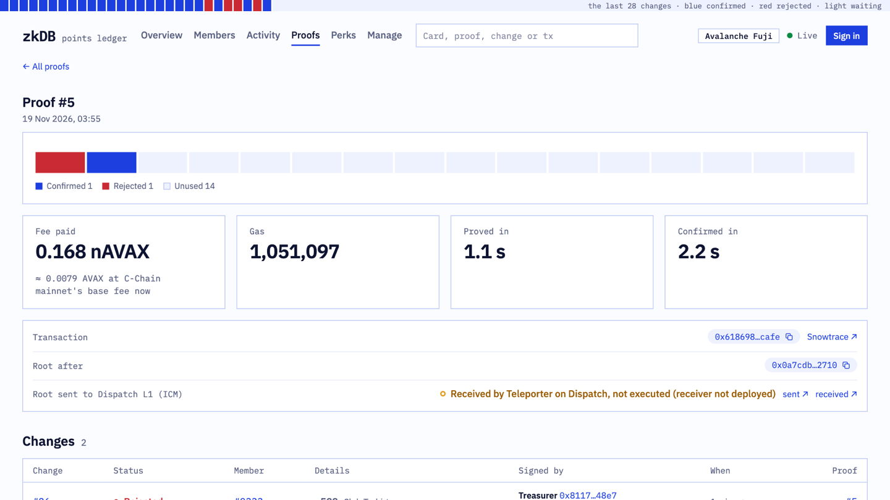
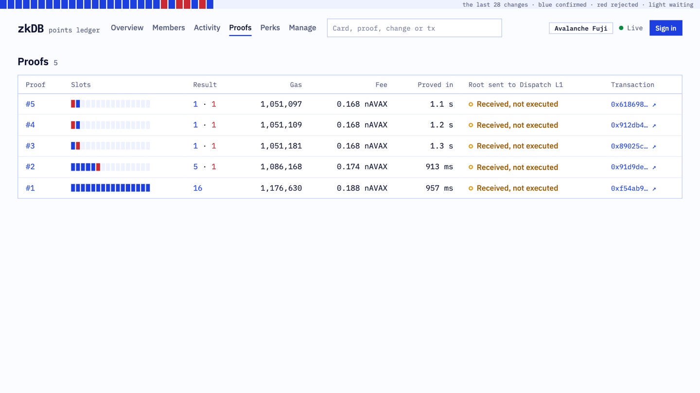

# zkDB

A points ledger for student clubs. A balance cannot change without a permanent public record of who signed it, taking points away (a redemption or a correction) needs two signers, and a member can prove "I have at least 500 points" without revealing which card is theirs. Every batch of changes is checked by a validity proof (a SNARK) that a contract on Avalanche verifies.

**Slides:** _link added before submission_ · **Video (2 to 3 min):** _link added before submission_


The GIF was recorded against the Fuji deployment below on 19 Nov 2026 (1280 × 720 viewport, demo test accounts, seeded club). The treasurer proposes cutting card #0889 from 550 to 55 and a redemption of 500 points from a card that has 150; the auditor co-signs both; one proof applies the correction and rejects the overspend; a member proves "at least 500 points" without naming the card; a card with too few points gets "No proof exists"; the proof page shows the root was received on Dispatch and not executed.

## The problem

Vietnamese students collect points for volunteering: *Mùa hè xanh* days, blood drives, community-service days. The points feed the official *điểm rèn luyện*, which goes on the transcript and decides scholarships ([Thông tư 40/2026/TT-BGDĐT](https://datafiles.chinhphu.vn/cpp/files/vbpq/2026/5/40-bgddt.pdf), Điều 17 and 18.6). About 2.6 million undergraduates at 226 institutions are scored this way ([Tuổi Trẻ, 9 Oct 2026](https://tuoitre.vn/hon-27-trieu-nguoi-dang-hoc-tu-dai-hoc-den-tien-si-o-viet-nam-100261009084431012.htm); [Tiền Phong, 4 Oct 2026](https://tienphong.vn/226-co-so-giao-duc-dai-hoc-va-bai-toan-sap-xep-tranh-trung-lap-post1882018.tpo)).

The record is kept by whoever runs the activity, in a spreadsheet or a school portal, and that same party is the only one who can check it. Two things that went wrong:

- In 2026 three defendants were sentenced for making or selling fake community-service certificates to students of Saigon Technology University (STU). One made 373 certificates for 63 students (13 years 6 months, not appealed). One bought certificates from him and sold 204 to 32 students (10 years on appeal). One made 53 and sold 23 of them to 4 students at 400,000 VND per set of 15 days (9 years on appeal) ([Tiền Phong, 24 Jun 2026](https://tienphong.vn/giam-an-cho-2-bi-cao-ban-giay-xac-nhan-rom-cho-sinh-vien-truong-dai-hoc-cong-nghe-sai-gon-post1854004.tpo)). zkDB would not have stopped an insider who signs a false award. It would have put every award on a public record under the signer's address, where a school can see who issued it and when.
- One university's scoring software gave many students an average mark by mistake ([VietNamNet, 25 Sep 2014](https://vietnamnet.vn/sinh-vien-phai-lam-lao-cong-doi-diem-ren-luyen-198908.html)).

The new regulation asks for results that are "khách quan, công bằng, công khai, minh bạch", gives students at least five days to object before a result is final (Điều 18.4), and scores schools on digital transformation of student affairs (Điều 27.6a). A member whose 1,250 points became 250 still has no way to see who changed it.

## What zkDB does about it

| | |
|---|---|
| Every change is public and names its signer | The op and the account that asked for it are in an event; the member page shows "Signed by" on every row |
| A treasurer cannot take points away alone | On a table with an auditor, a redemption or a correction is only a proposal until the auditor co-signs it on-chain. A correction then reads *Corrected*, with both addresses, for good. One signer can still award points and add a member |
| Spending more than the balance does nothing | The proof marks the redemption *Rejected* and the balance stays |
| A member can prove eligibility without showing the card | "A card in this ledger has at least N points and I hold its secret", proven in the member's browser, checked by a contract. This part is zero-knowledge |
| Anyone can re-check everything | The browser re-runs every change from chain data and compares its root with the contract's |

## Live on Avalanche Fuji

| Contract | Address | Verified |
|---|---|---|
| ZkDB (queue, roles, co-signed changes, root) | [`0x1dd3f88db29ee55e66b8db243c99c5b7fc0ea91c`](https://testnet.snowtrace.io/address/0x1dd3f88db29ee55e66b8db243c99c5b7fc0ea91c) | yes |
| BatchVerifier (UltraHonk, batch circuit) | [`0xf5100724394b96775a74950452e6565f78c7ec5d`](https://testnet.snowtrace.io/address/0xf5100724394b96775a74950452e6565f78c7ec5d) | yes |
| PointsGate (perks by zero-knowledge claim) | [`0xe68736b7dc375a90635dec5b07e09838f4fc4c33`](https://testnet.snowtrace.io/address/0xe68736b7dc375a90635dec5b07e09838f4fc4c33) | yes |
| ClaimVerifier (UltraHonk, claim circuit) | [`0xa6728051568ccf503e57ee5ba579a7ae8a4ab4a5`](https://testnet.snowtrace.io/address/0xa6728051568ccf503e57ee5ba579a7ae8a4ab4a5) | yes |
| RootRelay (sends each root over ICM) | [`0x497e8189dc2d2cc07712f448f51fbe708e2e306f`](https://testnet.snowtrace.io/address/0x497e8189dc2d2cc07712f448f51fbe708e2e306f) | yes |

"Verified" means source-verified on Routescan, the explorer behind testnet.snowtrace.io. This is the third deployment; the two earlier ones are superseded and the dashboard no longer reads them.

State on 19 Nov 2026: 8 members, 28 changes, 5 proofs, 8 co-signed changes (3 corrections, 5 redemptions), 2 perk claims. 5 roots sent over ICM: each was received by Teleporter on Dispatch and not executed, because the receiving contract is not deployed there (see Why Avalanche: ICM). Check it yourself:

```bash
RPC=https://avalanche-fuji-c-chain-rpc.publicnode.com
cast call 0x1dd3f88db29ee55e66b8db243c99c5b7fc0ea91c "batchCount()(uint64)" --rpc-url $RPC   # 5 or more
cast call 0x1dd3f88db29ee55e66b8db243c99c5b7fc0ea91c "head()(uint64)" --rpc-url $RPC         # 28 or more
cast call 0xe68736b7dc375a90635dec5b07e09838f4fc4c33 "perk(uint256)((uint256,uint64,uint64,string))" 0 --rpc-url $RPC
```

Transactions worth opening:

| What | Transaction |
|---|---|
| Proof #1, 16 changes, 1,176,630 gas | [0xf54ab96c…](https://testnet.snowtrace.io/tx/0xf54ab96ce9fc38d5f4c3291a3dbd2d49749b676821d6548c8ce5972b14b54c98) |
| Treasurer proposes #0042 1,250 → 250 | [0x550a7469…](https://testnet.snowtrace.io/tx/0x550a7469a9c2af5454b0d71027235af97eafcff77d338d31e8fb0a90e4d462f2) |
| Auditor co-signs it | [0xa0547c84…](https://testnet.snowtrace.io/tx/0xa0547c84b5a1e03772022aa2db7e72a88e5483d07fd9cc1a51410a276a1ae2d2) |
| Zero-knowledge perk claim, made out to a pickup code, 852,392 gas | [0xbf92b577…](https://testnet.snowtrace.io/tx/0xbf92b5772f620a4c2a28a1d088965c456976a69784170e4f21617fbe504bb5be) |
| The perk handed out at the desk against that pickup code | [0x52d9bfec…](https://testnet.snowtrace.io/tx/0x52d9bfec14f46e9c5cd1875accd07166a120ab0a2288c061dac90adcf2c7ef99) |
| A claim proved in a browser while recording the GIF, sent by the relayer | [0x69f6e573…](https://testnet.snowtrace.io/tx/0x69f6e57345f34132bd8aab86988e5b0a44b8908a227bdb8636ccfd4a57ec3c6e) |
| Root #3 sent over ICM from the C-Chain | [0xfb2051b1…](https://testnet.snowtrace.io/tx/0xfb2051b1c2b29a87cff8f313e7dd1a6f2f5cdddba3e6266578d86837d6224832) |
| Teleporter on Dispatch receives it and cannot execute it (`MessageExecutionFailed`: no contract at the destination) | [0x6488cdb7…](https://subnets-test.avax.network/dispatch/tx/0x6488cdb7f318c9177d0efdba0c1e1fcb2643558b92a43f57e694052436fc9f26) |

All 41 seeding transactions with gas, fee and confirmation time: [docs/fuji-measurements.md](docs/fuji-measurements.md).

| | |
|---|---|
|  |  |
|  |  |
|  |  |

## How it works

1. Queue. The treasurer awards points or adds a member. Each action is one transaction that appends an op to the contract's queue. Nothing changes yet; it shows as *Waiting*.
2. Take away, with two signatures. To redeem points or overwrite a balance the treasurer calls `proposeChange`. The op enters the queue only when the table's auditor calls `approveChange` with the same op (or `declineChange`).
3. Prove. A prover takes up to 16 waiting ops from the chain, applies them to a Poseidon2 Merkle tree and makes an UltraHonk proof (Noir circuit, bb.js) that `oldRoot → newRoot` followed the rules. An op that breaks a rule gets `ok = false`, and the proof covers that too.
4. Verify. `submitBatch` checks the ops against the queue, calls the on-chain verifier and only then stores the new root. Anyone can call it.
5. Relay. `RootRelay` sends the new root to another Avalanche L1 through Teleporter (ICM).
6. Check. Any browser rebuilds the database from the public op log and compares roots: *Data verified* or *Data does not match*.
7. Claim. On the Perks page the member's browser, which holds the card's secret, proves "a card in the current root has at least N points" and makes the claim out to the hash of a one-time pickup code. A relayer sends the proof to `PointsGate`, which checks it against `ZkDB.root()`. A copied proof cannot be redirected: the pickup hash is a public input of the proof, and only the holder of the code can collect the perk at the desk (`collect`).

Diagrams, the opcode table and the threat model: [docs/ARCHITECTURE.md](docs/ARCHITECTURE.md). Circuits and toolchain: [docs/design.md](docs/design.md).

## Why a proof and not a plain contract

A fair question, because the ops are public and a mapping with `require(balance >= amount)` enforces the same spending rule. We measured it: the same 16 changes on an ordinary-storage ledger and on zkDB, real receipts, real proof.

| 16 changes | Plain contract | zkDB |
|---|---:|---:|
| Total gas | 750,342 | 2,443,709 |
| Per change | 46,896 | 152,731 |

`npm run gas:compare -w @zkdb/dashboard` reproduces this; details in [docs/gas-comparison.md](docs/gas-comparison.md). zkDB costs 3.3 times as much, and a bigger batch does not fix that while each change is queued in its own transaction. A design that posts changes only inside the batch would break even at about 28 changes per proof; we calculated that and did not build it.

So gas is not the reason. The proof is there for what a plain contract cannot do:

1. Private claims. `PointsGate` accepts "some card in this ledger has at least N points" without learning which card. A plain contract can check a balance only if it is told whose. The claim needs the whole ledger as one Merkle root that a circuit can open cheaply, which means a Poseidon2 tree.
2. That root is too expensive to keep by hand. Updating a depth-20 Poseidon2 tree inside the EVM takes 40 hashes per change, about 812,000 gas with the cheapest public implementation ([zemse/poseidon2-evm](https://github.com/zemse/poseidon2-evm), 20,304 gas per hash by its own report; calculated, we did not run it). The batch proof keeps the same root correct for 152,731 gas per change.
3. One root travels. 32 bytes stand for every balance. `RootRelay` sends them towards another L1 over ICM for 144,197 gas, and a gate there could check the same claims with no copy of the ledger and no trust in the club's server. Only the sending half is live today (see below).

If a club needs none of the three, a plain contract is the better choice. On the words: the batch proof is a validity proof and hides nothing. Only the claim is zero-knowledge.

## Why on-chain, why Avalanche, where the money comes from

| Question | Answer |
|---|---|
| Why on-chain | The party that keeps the points is the party accused when they are wrong. The op log, the signers and the root sit in a contract nobody at the club can edit, and anyone can rebuild every balance from it. |
| Why Avalanche: speed | A treasurer presses *Prove* and sees *Proof accepted* on the same screen. Over the 41 seeding transactions the median time from broadcast to receipt was 2.5 s (p90 3.0 s, slowest 3.6 s). The two proofs made live from the dashboard confirmed in 2.1 and 2.2 s. |
| Why Avalanche: cost | A proof is 1.05 to 1.18 M gas; an award is 67,502 gas. On Fuji these cost 160 wei per gas: a 10 wei base fee plus the wallet's 150 wei tip, so a proof cost 0.16 to 0.19 nAVAX. At the C-Chain mainnet base fee on 18 Nov 2026 (7.5 nAVAX, `cast base-fee --rpc-url https://api.avax.network/ext/bc/C/rpc`) a proof would cost about 0.0079 to 0.0088 AVAX and an award 0.0005 AVAX. The mainnet figures are gas × base fee; we did not pay them. |
| Why Avalanche: ICM | Each proven root is sent from the Fuji C-Chain to the Dispatch L1 through Teleporter. The public relayer carries it over within seconds and Teleporter on Dispatch receives it ([sent](https://testnet.snowtrace.io/tx/0xfb2051b1c2b29a87cff8f313e7dd1a6f2f5cdddba3e6266578d86837d6224832), [received](https://subnets-test.avax.network/dispatch/tx/0x6488cdb7f318c9177d0efdba0c1e1fcb2643558b92a43f57e694052436fc9f26)). It is not executed: the receiving contract, `RootMirror`, is written and tested but not deployed, because we have no gas on Dispatch. Teleporter emits `MessageExecutionFailed` and keeps each message so it can be retried. Nothing on Dispatch stores or uses the root today. `npm run deploy:mirror -w @zkdb/dashboard -- --simulate` asks the Dispatch RPC to run Teleporter's `retryMessageExecution` for the latest stored root with `RootMirror`'s code placed at its address (an `eth_call` state override, no gas): the call succeeds, and without the override it reverts with "destination address has no code". With DIS on the deployer, the same script without `--simulate` deploys `RootMirror`, a `PointsGate` there and retries the stored message for real. |
| Why Avalanche: Data API | The dashboard reads sender, block time and fee for the contract's transactions from the Avalanche Data API (Glacier) in one request, and falls back to the RPC. |
| Own L1 (designed, not deployed) | A consortium of universities runs an Avalanche L1: each school's IT office runs a validator (proof of authority), the transaction allow-list admits only treasurers, auditors and the claim relayer, and gas is a token the consortium hands out, so a student-affairs office pays a hosting bill in VND and nobody buys crypto. Each school's root goes to the C-Chain over ICM as a public anchor and to the other schools, so school B can accept a claim about points earned at school A. What exists today is the relay from the C-Chain to Dispatch. |
| Where the money comes from | No token and no yield. Points have no cash value and cannot be bought, sold or moved. The costs are gas and hosting. The buyer we aim at is a university's student-affairs office (Phòng Công tác sinh viên) or its Đoàn Thanh niên and Hội Sinh viên, paying in VND for the dashboard, the prover and the claim relayer. No school has seen this yet, and we have no price validated with one. |

What a semester would cost in gas for a club of 200 members, from the gas measured on Fuji:

| | Gas | AVAX at 7.5 nAVAX |
|---|---:|---:|
| 200 members join | 18,118,000 | 0.136 |
| 800 awards | 54,001,600 | 0.405 |
| 200 redemptions (propose + co-sign) | 32,669,800 | 0.245 |
| 10 corrections (propose + co-sign) | 1,633,080 | 0.012 |
| 76 proofs of 16 changes | 89,423,880 | 0.671 |
| 76 roots relayed over ICM | 10,958,972 | 0.082 |
| 100 perk claims | 85,239,200 | 0.639 |
| 100 perks handed out at the desk | 2,956,000 | 0.022 |
| **Total** | **295,000,532** | **2.21** |

About 2.2 AVAX, or roughly 390,000 VND at 176,430 VND per AVAX (CoinGecko, 18 Nov 2026). This is a calculation from the gas in [docs/fuji-measurements.md](docs/fuji-measurements.md). On Fuji the same gas cost 0.00000005 AVAX.

## For a member

- No wallet. A member is a card number such as `#0042`. Reading the ledger needs nothing; claiming a perk needs the card's secret, and a relayer pays the gas.
- The member's own device makes the card's secret. On the Perks page, *Make my card secret* creates a random secret, keeps it in that browser and shows an enrol code, its Poseidon2 hash. The treasurer types only the enrol code into *New member*; the club never sees the secret. Names and student IDs never leave the club.
- A claim gives the member a one-time pickup code. The perk is handed out once, to whoever shows that code at the desk.
- To dispute a change, a member opens their card's page. Each row has the signer's address, the proof and the transaction. A correction shows both signers. The fix for a wrong correction is another co-signed correction, which also stays visible.
- What a member cannot do yet: refuse a redemption. A treasurer and the auditor together can record one the member did not make. It is public and names both.

## Who else does this

| | What it is | Difference |
|---|---|---|
| School portals and apps ([TDTU Student](https://apps.apple.com/be/app/tdtu-student/id6475330691), [UEH Student](https://apps.apple.com/vn/app/ueh-student/id1560073124), in-house modules at HCMUTE and Cần Thơ University) | Activity check-in and conduct scores | One operator writes and audits the data. A student sees a result, not who changed it |
| [Certificate Transparency](https://certificate.transparency.dev/howctworks/), [Trillian](https://github.com/google/trillian), [immudb](https://github.com/codenotary/immudb) | Append-only Merkle logs and databases with cryptographic proofs | Tamper-evident, but the operator still decides what goes in, and there are no rules proven per change |
| [Space and Time Proof of SQL](https://spaceandtime.io/blog/proof-of-sql), ZK coprocessors (Axiom, Brevis, Lagrange) | Prove a query result over existing data | They prove reads. zkDB proves writes against rules and keeps the state root on-chain. We found no Avalanche deployment of these in their public docs |
| [Semaphore](https://docs.semaphore.pse.dev/) | Anonymous proof of group membership | Closest to the claim. Semaphore proves "I am in the group"; the claim proves a property of a balance that changes with every batch. Avalanche is not in its [deployed list](https://docs.semaphore.pse.dev/deployed-contracts) |

What is new here is the combination for this use: proven writes, two-signature corrections that stay flagged, and a private claim over a balance, in one small deployment.

## Vietnamese law and data

- Crypto is not legal tender in Vietnam and payments are made in VND. zkDB takes no payments. Points are not money or crypto assets, and the only coin involved is test AVAX for gas.
- Personal data ([Luật 91/2025/QH15](https://vneconomy.vn/nhung-diem-moi-trong-luat-bao-ve-du-lieu-ca-nhan-tu-112026.htm), in force 1 Jan 2026, and [Nghị định 356/2025/NĐ-CP](https://luatvietan.vn/diem-moi-cua-nghi-dinh-356-2025-so-voi-nghi-dinh-13-2023-ve-huong-dan-bao-ve-du-lieu-ca-nhan.html), which replaced Nghị định 13/2023): nothing personal goes on-chain. On-chain there are card numbers, balances, reason codes and hashes.
- *Điểm rèn luyện* is set by each school under Thông tư 40/2026. zkDB is a record a club or office can show; it does not replace the official decision.

## What is real and what is demo setup

- Real: the five contracts on Fuji, every batch proof and claim proof (generated by bb.js, accepted by the on-chain verifiers), all balances and history (read from chain events), gas and fees (from receipts), ICM sends, and Teleporter's receipt of each message on Dispatch (read from Teleporter there; it shows each one as not executed).
- Seeded story: the club, the campaign, the card numbers and the reasons. `npm run deploy:fuji` wrote them.
- Demo card secrets. The seeded cards have random secrets that the deploy script wrote to a gitignored file on the recording laptop (`.demo-cards.fuji.local`); they are not in the repo. With `ZKDB_DEMO=1` the local server offers them as chips on the Perks page so the recording needs no typing. Whoever holds that file can tell which demo card made a claim.
- Demo accounts (a dev toggle, off by default). Started with `ZKDB_DEMO=1`, the dashboard server offers the test keys from its local env file (gitignored) in the sign-in dialog as Owner, Treasurer and Auditor, and signs for them. Our recordings use this; there is no wallet popup in them. Without the flag the routes do not exist and sign-in is Core or MetaMask (SIWE, no gas); a production build never asks for them. With the flag, the server answers only on its local address, only to the dashboard's own origin with a per-launch token, and the keys sign only this dashboard's sign-in message and a fixed list of calls per role (see the threat model).
- Claim relayer: a funded test key on the dashboard server pays the gas of claims, capped per hour.
- One laptop. The owner, treasurer, auditor and relayer test keys all sit in one file on the recording laptop. The two-signer rule is enforced by the contract; in this demo one person holds both keys. In use, the treasurer and the auditor would be different people with their own wallets.
- Timing: proving time is measured by the server and confirmation time by the browser that sent the proof. They are kept in [`packages/dashboard/server/proof-meta/`](packages/dashboard/server/proof-meta) and are display only.
- Not deployed: `RootMirror` and a second `PointsGate` on Dispatch (so the ICM messages are received there and not executed), and any L1 of our own.

## Development timeline

- 16 October 2026. The batch circuit, Poseidon2 tree, TypeScript prover and first on-chain verifier.
- 2 to 19 November 2026. The points dashboard, wallet sign-in, co-signed corrections, private perk claims and Fuji deployments.

## Run it

Needs Node 20+ and npm. The local demo also needs [Foundry](https://getfoundry.sh) (`anvil`, `forge`).

```bash
git clone https://github.com/onlyvu/zkdb.git && cd zkdb
git submodule update --init          # forge-std, for the contracts
npm ci

# Read the Fuji deployment (browsing needs no wallet)
npm run fuji -w @zkdb/dashboard      # http://localhost:5173

# For recording on Fuji: check gas, queue and demo cards first (-- --restage fixes what it can),
# then offer the test keys from .env.fuji.local as demo accounts
npm run prerecord -w @zkdb/dashboard
ZKDB_DEMO=1 npm run fuji -w @zkdb/dashboard

# Or a fresh local chain with the same story and test accounts
npm run demo -w @zkdb/dashboard      # anvil on 8559, API on 8788, UI on http://localhost:5173
```

On the local demo, *Sign in* lists anvil's test accounts: the first is the owner, the second the treasurer, the third the auditor. On Fuji, writing needs a wallet that holds a role, or `ZKDB_DEMO=1` with the test keys; reading and the Perks page do not (claims need the server to have a relayer key).

The compiled circuits and both verifiers are committed, so none of this needs the Noir toolchain. To rebuild them: `./scripts/install-tools.sh && ./scripts/build-circuits.sh` (nargo 1.0.0-rc.5, bb 5.0.0).

## Tests

| Suite | Count | Command |
|---|---:|---|
| Contracts (Foundry, real proof fixtures) | 48 | `cd contracts && forge test` |
| Core: tree, Poseidon2 vectors, VM, batch prover, claim prover | 30 | `npm test -w @zkdb/core` |
| Dashboard: replay, points, forms, Data API reader, API and gate on a real anvil chain | 78 | `npm test -w @zkdb/dashboard` |
| Circuits (Noir): 18 tree and op, 2 batch, 9 claim | 29 | `cd circuits && nargo test --workspace` (needs nargo) |

The core suite generates and verifies a real batch proof and a real claim proof. The dashboard suites start anvil and deploy the real contracts; the batch API test submits a committed fixture proof on-chain, the gate test relays committed claim proofs through the server and checks every refusal of the demo-account endpoint (no flag, wrong Host, wrong Origin, no token, a message that is not a sign-in, a call outside the role's list). They are skipped when Foundry is missing. `npm run typecheck` and `npm run build` pass in both packages.

Benchmarks: [docs/benchmarks.md](docs/benchmarks.md).

## Limits

- Ops and balances are public. Only the claim hides something, and only among the cards that qualify: with 4 qualifying cards on the demo, a claim hides which of the 4.
- A treasurer and an auditor together can record a redemption the member did not make. It is public and names both.
- One prover server per deployment. `submitBatch` accepts a valid proof from anyone, so a second prover can take over; nobody runs one.
- A batch holds 16 ops. More wait for the next batch. If ops arrive while a proof is being made, the proof still fits the front of the queue.
- The dashboard trusts its RPC for completeness of the log. A mismatch shows as *Data does not match*; point `VITE_RPC_URL` at your own node to remove the trust.
- The owner is one key and can change writers and auditors. Ownership transfer is two-step so it can move to a Safe; it has not.
- A new circuit means a new verifier and a new `ZkDB` deployment started from the old root. We have not done a migration.

## Repository

| Path | What |
|---|---|
| `circuits/` | Noir: Poseidon2 Merkle tree, op semantics, the 16-op batch circuit, the claim circuit |
| `contracts/` | `ZkDB.sol`, `PointsGate.sol`, `icm/RootRelay.sol`, `icm/RootMirror.sol`, generated verifiers, tests |
| `packages/zkdb` | TypeScript mirror of the tree and VM, batch builder, provers |
| `packages/dashboard` | React dashboard, API server, deploy, demo and measurement scripts |
| `docs/` | Architecture, design, benchmarks, Fuji measurements, gas comparison |
| `DEMO_FLOWS.md` | The demo, beat by beat |

## Maintainer

[onlyvu (Vu Viet Anh)](https://github.com/onlyvu)

MIT licence, see [LICENSE](LICENSE).
