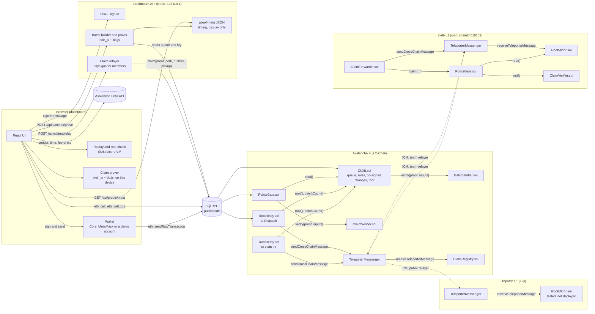
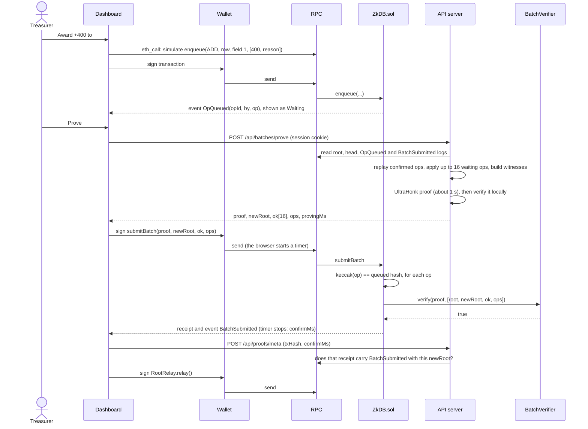
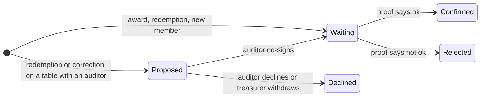
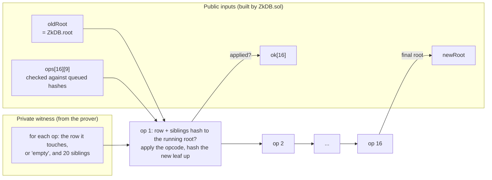
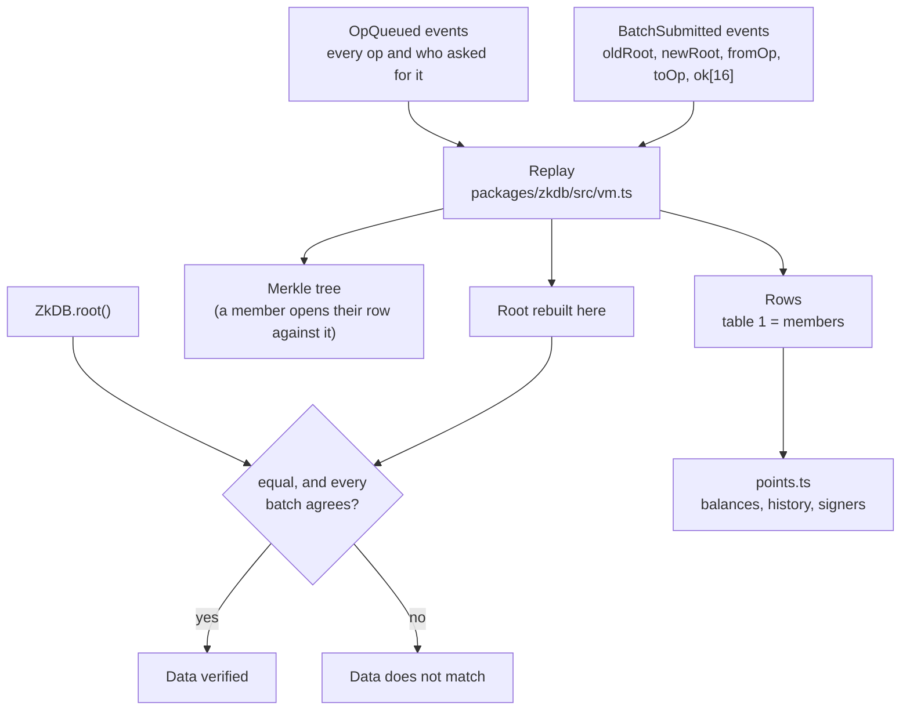
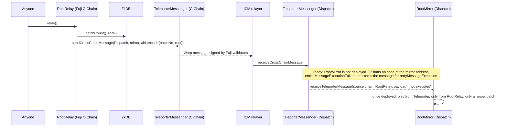
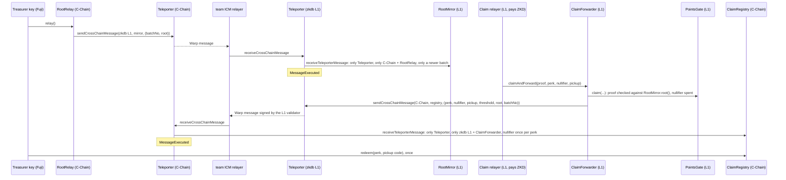

# Architecture

zkDB has five parts:

- two Noir circuits: one says what a valid batch of changes is, one lets a member prove a fact about their own row;
- contracts on Avalanche that queue changes, verify proofs, hold the root, gate perks and relay the root over ICM to our own L1, which sends claim receipts back;
- a TypeScript core that mirrors the circuit;
- an API server that proves batches and relays claims;
- a React dashboard.

The points ledger is one table of that database, shown in points terms. Circuit inputs, the op format and the toolchain are in [design.md](design.md).

## System

Arrows point from the caller to what it calls. Every read and every transaction goes through an RPC endpoint; the wallet is only where the key is.



### What the browser trusts

| Source | Used for | If it lies |
|---|---|---|
| The RPC | the root, the op log, batch events | A wrong op or root makes the replay disagree: *Data does not match*. A withheld recent op makes the page stale, not wrong. Point `VITE_RPC_URL` at your own node, or compare `root()` on a second RPC |
| Avalanche Data API | sender, block time and fee shown next to a change | Display only. The signer shown in "Signed by" comes from the `OpQueued` event, not from here. If the API is down the dashboard reads blocks and receipts from the RPC |
| `/api/proofs/meta` | "Proved in" and "Confirmed in" | Display only. Nothing is verified with it |
| The API server | making batch proofs; relaying claims | It can refuse or delay. It cannot change a result: the contract checks the ops against its own queue and the proof against its own root |
| The other L1's RPC | "Received by Teleporter on Dispatch, not executed (receiver not deployed)" next to a relayed root | Display only |
| The zkdb L1 | the mirrored root, claims checked on the L1 | `ClaimRegistry` on Fuji trusts receipts that Teleporter delivers from `ClaimForwarder` on the zkdb L1, i.e. it trusts that L1's validator set (one validator today). The receipts name the root they were checked against, which anyone can compare with `ZkDB` root history on Fuji |

## Award, prove, verify



`confirmMs` is the time between the browser broadcasting `submitBatch` and holding its receipt. `provingMs` is measured inside the server around proof generation.

## The life of a change



- *Proposed* and *Declined* exist only for redemptions and corrections (SUB, SET, DELETE) on a table with an auditor. Neither touches the queue or the balance.
- *Waiting*: the op is in the queue, in order, and cannot be removed or reordered.
- *Confirmed* (shown as *Corrected* for a correction): the root changed.
- *Rejected*: the op stays in the history; the root did not change. A redemption above the balance ends here.

### Queue edge cases

- More than 16 waiting: a proof takes the first 16. The rest wait for the next proof.
- Ops arrive while a proof is being made: the proof is for the front of the queue, so it still fits. `submitBatch` consumes exactly the ops it was given.
- Someone else submits first: the second `submitBatch` reverts (`TooManyOps` or `OpMismatch`) and costs only that failed call. Press *Prove* again.
- A proof cannot be made for an op: this cannot happen for a queued op. The contract refuses values outside the field, opcodes outside 2 to 5 and unknown rows before queueing, and every rule violation inside the circuit is an `ok = false`, not a failure.
- Who can call `submitBatch`: anyone. The dashboard server only proves for signed-in accounts with a role, to protect its CPU; a second prover needs no permission from the contract.
- Nobody proves: changes stay *Waiting*. They are public the whole time.

## What the batch circuit checks



The tree has depth 20 and uses Poseidon2. A leaf is `Poseidon2(table_id, f0..f5)`. An op is `[opcode, rowId, a, v0..v5]`:

| Opcode | Meaning | In the points ledger | `ok = false` when |
|---|---|---|---|
| 0 NOOP | padding | unused slots | never |
| 1 INSERT | new row in table `a` | a member joins | the slot is taken |
| 2 SET | `f[a] = v0` | correction | the row is empty |
| 3 ADD | `f[a] += v0` | award | the row is empty, or a value is not a u64, or the sum overflows |
| 4 SUB | `f[a] -= v0` | redemption | the row is empty, or a value is not a u64, or `v0` is more than the balance |
| 5 DELETE | clear the row | a member is removed (also a correction) | the row is empty |

## Where the browser's verdict comes from



`ok[16]` reaches the browser in the `BatchSubmitted` event. The contract emits the same array it passed to the verifier as public inputs, so the flags are the ones the proof is about. The replay computes its own flags and compares; it never overrides the proven ones.

## A perk claim

```mermaid
sequenceDiagram
  actor M as Member
  participant UI as Dashboard (member's browser)
  participant S as API server (relayer)
  participant G as PointsGate.sol
  participant Z as ZkDB.sol
  participant V as ClaimVerifier

  M->>UI: card secret, perk
  UI->>UI: find the row whose key is Poseidon2(secret) in the replayed rows
  UI->>UI: make a one-time pickup code; pickup = its hash
  UI->>UI: prove: row is in root, key matches, balance >= minPoints, nullifier = Poseidon2(secret, perk); pickup is a public input
  UI->>S: POST /api/claims/relay (proof, perk id, nullifier, pickup)
  S->>G: eth_call claim(...) first, then send it
  G->>Z: root()
  G->>V: verify(proof, [root, table, minPoints, perk, nullifier, pickup])
  V-->>G: true
  G-->>UI: event PerkClaimed(perk, nullifier, root), claim recorded under pickup
  M->>G: at the desk: collect(perk, code), sent by the treasurer; only once, only if hash(code) = pickup
```

The secret, the row and its position never leave the browser. The server and the chain see the perk, the threshold, the nullifier and the pickup hash. A copy of the proof sent first by someone else records the claim under the member's own pickup hash, so the copier cannot collect the perk. Because balances are public, an observer can list the cards that qualify; the claim hides which of them it was.

If the card has too few points the witness cannot be built, and the page says so before proving. If a batch lands between proving and sending, the gate rejects the proof against the new root and the member proves again.

## The root on another L1 (ICM)



Deployed and working: everything up to Teleporter on Dispatch receiving the message. It is received by Teleporter on Dispatch and not executed, because the receiver is not deployed; nothing on Dispatch stores or uses the root. Not deployed: `RootMirror` itself, and a `PointsGate` beside it. Both are tested with a mock messenger (`contracts/test/RootRelay.t.sol`), including a real claim accepted by a gate that reads only the mirrored root. The mirror's address is fixed in advance (first contract of a dedicated deployer key), so `RootRelay` already sends to it. `npm run deploy:mirror -w @zkdb/dashboard -- --simulate` runs Teleporter's `retryMessageExecution` for the latest stored root as an `eth_call` with `RootMirror`'s code placed at that address, which succeeds; without `--simulate` the script deploys the mirror and the gate once that key has gas on Dispatch, then retries the stored message for real.

## The school L1 (zkdb): root in, claim receipt out (deployed)

`zkdb` is our own Avalanche L1 on Fuji (chainId 510102, token ZKD, subnetID `23UCnnKWGoJTeAf1Uzqjo5RBvoyJ2sYQ7UMqviBcTuYqUJPL97`, blockchainID `272pDkC2CtfGT5kMktHTCNi7homXticaHaf1bJyfkgk5BLzTiU`): Subnet-EVM, converted to a sovereign L1 on 21 Nov 2026, proof of authority with one validator on a team laptop, 30M gas per block. Since a network upgrade on 21 Nov 2026 (unix 1795199165) two precompiles are on: TxAllowList (only wallets the school enabled can send) and ContractDeployerAllowList (only the school deploys); see [l1/README.md](../l1/README.md) and the live demo in [l1-permissions.md](l1-permissions.md). The team's icm-relayer carries Teleporter messages both ways for free (zero fee). Runs and transaction hashes: [l1-run.md](l1-run.md).



Each side names a contract on the other side before it exists. The L1 addresses follow from the L1 deployer's nonce (no one else sends from it there), so `deploy:l1` puts `RootRelay` and `ClaimRegistry` on Fuji first, pointing at the predicted `RootMirror` and `ClaimForwarder`, then deploys the L1 contracts in nonce order and checks they landed there. The same `ClaimVerifier` as on Fuji fits the L1 (15.7 KB runtime, 3.45M gas to deploy); a claim through `ClaimForwarder` costs about 1.0M gas on the L1. Tests: `contracts/test/L1Claim.t.sol` (one mock messenger per chain: both directions, wrong sender, wrong source chain, direct call, duplicate nullifier, bad proof, receive gas under the limit).

Why this L1: the school runs the validator and holds the fee token, so students never pay AVAX; claims are checked and nullifiers spent on the school chain; the root and the receipts move over ICM so any Avalanche chain can honour a claim. The ledger itself stays on the C-Chain in this deployment. The allow-lists keep free ZKD gas from becoming free block space or fake perk gates for strangers. Not there yet: a fee manager, more than one validator, a public RPC. The dashboard's School L1 page (`src/l1view.tsx`) reads both Fuji ends of the link (RootRelay events, ClaimRegistry receipts and redemptions), since the L1 RPC is not public.

### An L1 for a group of universities (the next step; one school's L1 is deployed, above)

| Question | Design |
|---|---|
| Validators | One per participating school, run by its IT office, added through the L1's validator manager (proof of authority). Five schools give five validators |
| Who can transact | The transaction allow-list precompile admits treasurers, auditors and each school's claim relayer |
| Gas | A native token the consortium mints and hands to those accounts. Schools pay a hosting invoice in VND; nobody buys a coin. Low base fee, set through the fee-config precompile |
| What moves over ICM | Each school's root after every proof, to the C-Chain as a public anchor and to the other schools. A gate at school B can then accept a claim about points earned at school A |
| Why still a proof, if the schools run the validators | Validators agree on what was submitted. They do not check that a treasurer's change followed the rules, and a student or an outside office does not run a validator. The proof and the public log let anyone outside the consortium check a balance |

## Data model

| Thing | Where | Shape |
|---|---|---|
| Row | Merkle leaf | `Poseidon2(table_id, f0..f5)` |
| Member | row in table 1 | `[card number, balance, card key, 0, 0, 0]`, card key = `Poseidon2(secret)` |
| Op | `OpQueued(opId, by, op)`; `keccak256(op)` in storage | `[opcode, rowId, a, v0..v5]`; for points `a = 1`, `v0` = amount, `v1` = reason code |
| Proposal (redemption or correction) | `ChangeProposed`, `ChangeApproved`, `ChangeDeclined`; hash and proposer in storage | the same op, not yet queued |
| Batch proof inputs | built in `submitBatch` | `oldRoot, newRoot, ok[16], ops[16][9]` |
| Root | `ZkDB.root` | the only state the gate and the relay read |
| Perk | `PointsGate` storage | table, threshold, name, claim count |
| Claim | `PerkClaimed(perk, nullifier, root)` | nullifier = `Poseidon2(secret, perk)` |
| Timing | `server/proof-meta/<contract>.json` | proving ms, confirmation ms, by new root |

## Contracts

| Contract | Runtime size | What it holds |
|---|---:|---|
| `ZkDB.sol` | 6,998 bytes | roles, queue, co-signed changes, root history |
| `BatchVerifier.sol` | 16,572 | generated by `bb write_solidity_verifier --optimized` |
| `PointsGate.sol` | 3,040 | perks and used nullifiers |
| `ClaimVerifier.sol` | 15,726 | generated |
| `RootRelay.sol` | 1,517 | last relayed batch |
| `RootMirror.sol` | 931 | root and batch number on the other L1 |
| `ClaimForwarder.sol` | 2,402 | nothing: checks a claim through the gate and sends the receipt |
| `ClaimRegistry.sol` | 2,259 | claim receipts from the L1, used nullifiers, pickup states |

`submitBatch` costs 1.0 to 1.16 M gas whether the batch has 1 op or 14, because the verifier's work is fixed by the circuit ([benchmarks.md](benchmarks.md), [gas-comparison.md](gas-comparison.md)).

## Threat model

| Who | Can | Cannot | How we know |
|---|---|---|---|
| Treasurer (table writer) | Add members and award points on the table's rows. Propose a redemption or a correction | Take points away, overwrite or delete alone on a table with an auditor. Hide a change. Spend more than a balance | `ZkDB.t.sol`: `test_proposal_writerAloneCanOnlyAdd`, `test_proposal_queuedOnlyAfterAuditorApproves`, `test_proposal_redemptionQueuedOnlyAfterAuditorApproves`; `test/gate.test.ts` |
| Auditor | Co-sign or decline a proposal | Change what was proposed, or queue anything of their own | `test_proposal_auditorCannotChangeTheProposal`, `test_auditor_cannotAlsoBeTheTableWriter` |
| Former treasurer | Nothing on the table | Touch rows after the table is reassigned | `test_handover_newTableOwnerInheritsRows` |
| Prover (API server) | Choose when to prove; refuse | Skip, reorder or invent ops; fake a result | `rejectsOpsNotInQueue`, `rejectsFlippedOk`, `rejectsWrongNewRoot`, `rejectsReplay`; circuit tests |
| Claim relayer, or anyone who sees a claim in the mempool | Refuse to relay; copy the proof | Learn the card (it only sees the proof); send the copy first and take the perk: the proof is bound to the pickup hash, and `collect` needs the code behind it | `test_claim_copiedProofCannotBeRedirected`, `test_collect_onlyOnce_onlyForAClaim`; `test/gate.test.ts` checks the card key is not in the transaction |
| Someone without the card secret | Read every balance | Make a claim for that card, or claim twice | `claim` circuit tests `someone_elses_card_fails`, `invented_balance_fails`; `test_claim_eachCardOncePerPerk` |
| Owner | Add or remove writers, reassign tables, set or remove the auditor | Change rows or the root directly | The contract has no such function |
| Anyone | Submit a valid proof, relay the root, read everything | Submit an invalid proof, choose what the relay sends | Verifier; `test_relay_sendsTheProvenRootToTheMirror` |
| Another chain's contract | Send a message to `RootMirror` | Set its root, unless it is `RootRelay` speaking through Teleporter | `test_mirror_takesTheRootOnlyFromTheRelayOverTeleporter` |
| Someone with a stolen session cookie | Ask the server to run the prover | Send transactions | Cookie is HttpOnly, SameSite=Strict, HMAC-signed, 8 h; POSTs check Origin |

Sign-in is SIWE: nonces are single-use, expire in 5 minutes and are capped at 5,000; the message must name an allowed domain and the right chain; the signature is checked with `verifySiweMessage`. Covered by `test/api.test.ts`.

Known gaps:

- The owner is one key. It can remove the auditor, which turns the two-signature rule off, and that shows as a `TableAuditorSet` event.
- A treasurer can record a redemption the member did not make.
- The treasurer who creates a card sees its secret once. A real deployment should let the member's phone make the secret.
- Demo accounts make the local server a signer, so they are off unless it is started with `ZKDB_DEMO=1` (see the table below). Do not run that mode with real keys or on a shared host.
- Balances are public.
- One prover server.

### Demo accounts (`ZKDB_DEMO=1`)

A dev toggle for recording. With it, `POST /api/demo/wallet` signs with the Owner, Treasurer and Auditor test keys from the server's local env file. A signer on localhost is reachable by any page open in the same browser, and by a hostile site that points its own name at 127.0.0.1 (DNS rebinding), so each request has to pass every row:

| Check | Stops | Test (`test/gate.test.ts`) |
|---|---|---|
| The routes exist only with `ZKDB_DEMO=1`, and never when `NODE_ENV=production`; a production build of the page never calls them | A default `npm run fuji`, or a hosted copy, having a signer at all | `has no demo routes unless the server was started with the demo flag` |
| `Host` must be the dashboard's or the API's own local address and port | DNS rebinding: the attacker's page reaches 127.0.0.1 under its own name | `refuses a request whose Host is not the local dashboard` |
| `Origin` must be present and be the dashboard's; `Sec-Fetch-Site: cross-site` is refused; the body must be `application/json` | Another site's page posting to localhost (CSRF) | `refuses a missing or foreign Origin, and any cross-site request`, `refuses a body that is not JSON` |
| A random token made at each launch, given to the page as an HttpOnly, SameSite=Strict cookie, compared in constant time | A request that does not come from the page the server served to | `refuses a request without this launch's token` |
| `personal_sign` only for a SIWE message naming an allowed domain, this chain, this account and a nonce this server issued | Using the key to sign anything else | `signs nothing but a sign-in message this server issued a nonce for` |
| `eth_sendTransaction` only to `ZkDB` or `RootRelay`, only selectors on that role's list, no value | Using the key for other contracts, other roles' calls, ownership transfer or sending coins | `sends only the calls its role is allowed` |

Per role: the owner may call `setWriter`, `setTableOwner`, `setTableAuditor`, `submitBatch` and `relay`; the treasurer `insert`, `enqueue`, `proposeChange`, `declineChange`, `submitBatch`, `relay` and `PointsGate.collect`; the auditor `approveChange`, `declineChange`, `submitBatch` and `relay`. The contracts enforce the same roles again on-chain.

### Changing a circuit

Verifiers are immutable and `ZkDB` holds its verifier's address as an immutable. A new batch circuit therefore means a new `BatchVerifier` and a new `ZkDB`, constructed with the old contract's final root as its starting root; the old op log stays readable where it is. The claim circuit is independent: a new `ClaimVerifier` needs only a new `PointsGate`. We have not run such a migration.
